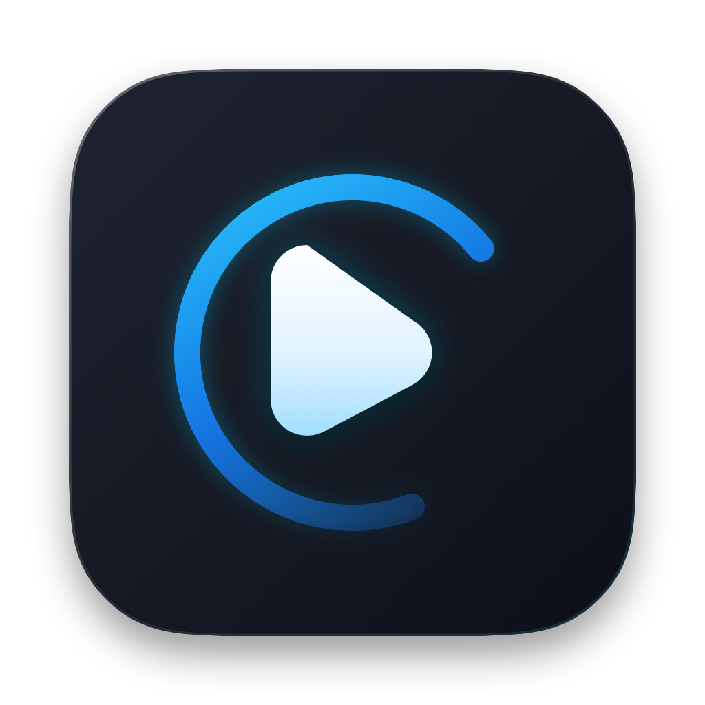
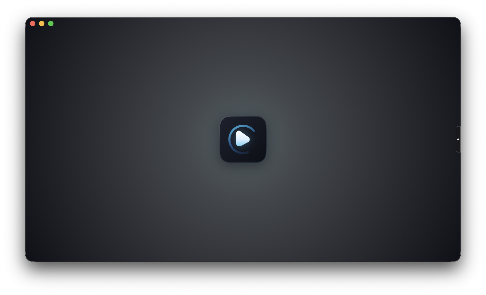
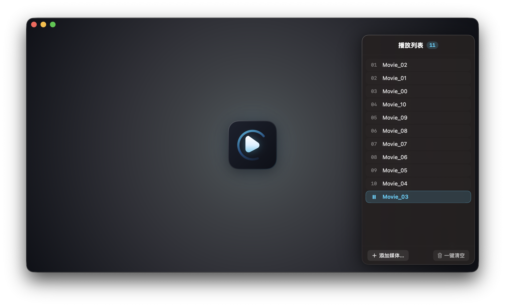
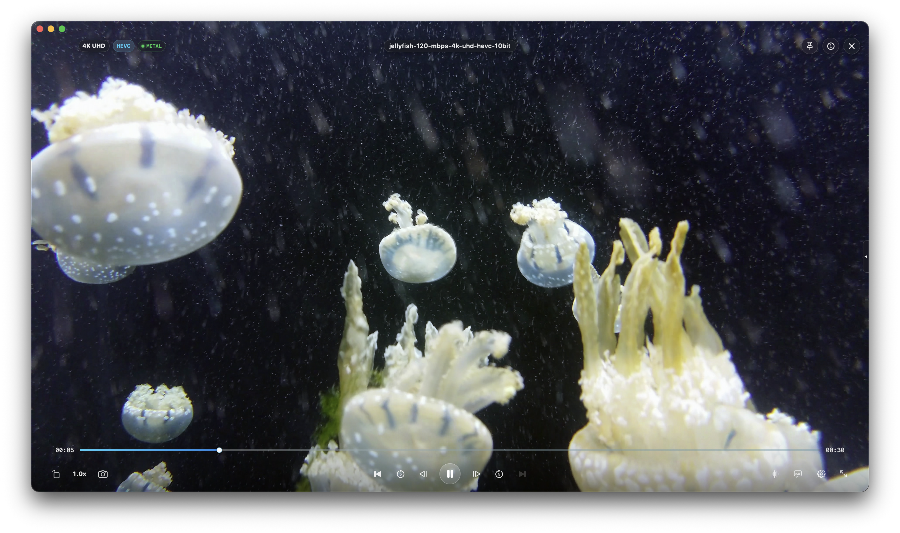
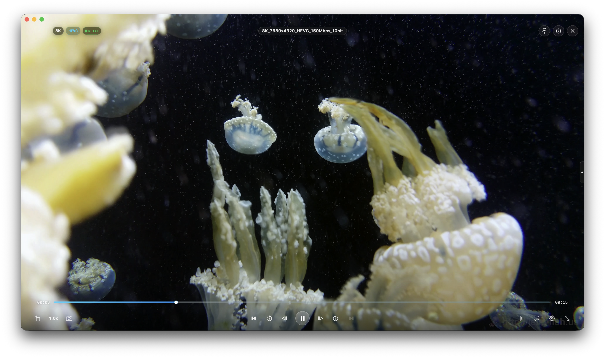
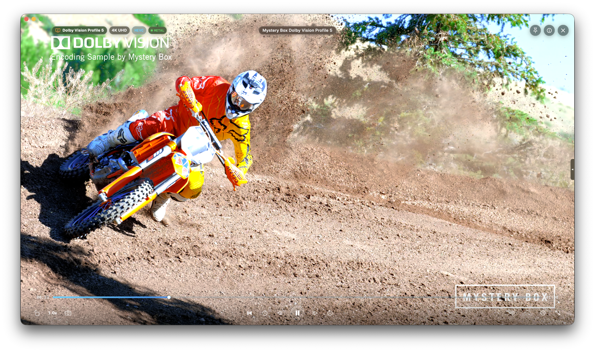
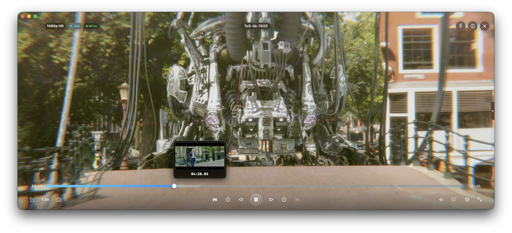
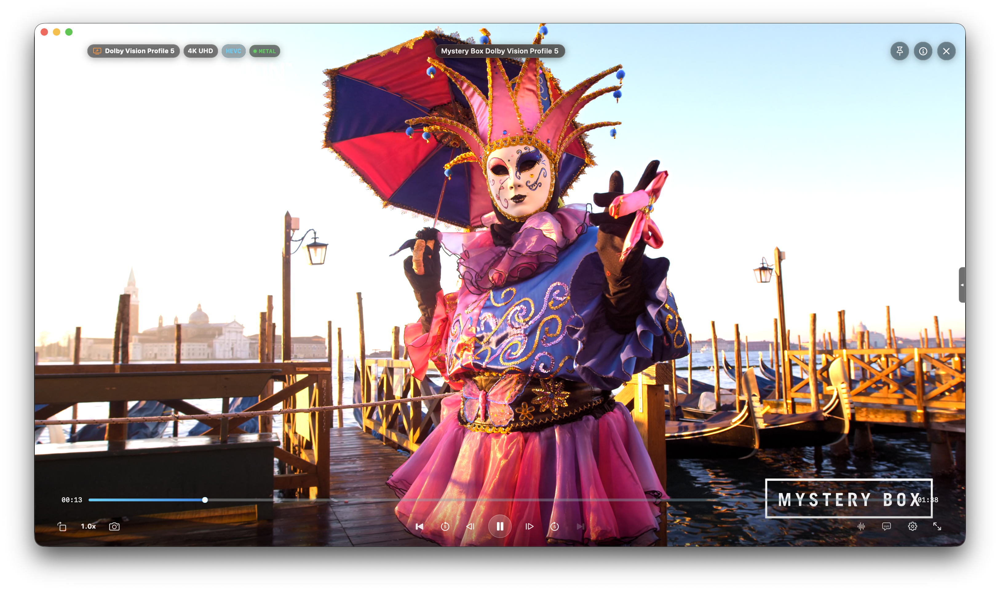
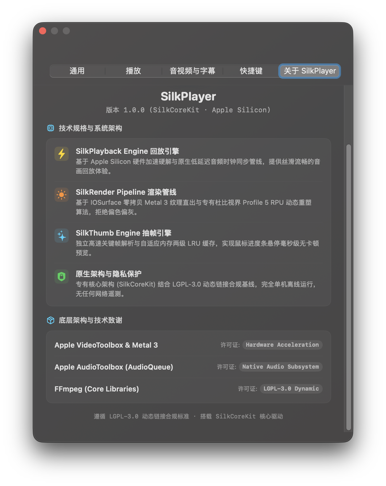

<div align="center">



# SilkPlayer

**A lightweight, native media player crafted for macOS.**  
Dedicated to lightweight performance, speed, ease of use, and a pure local viewing experience.

[](https://www.apple.com/macos/)
[](https://www.apple.com/mac/)
[](https://swift.org)
[](scripts/run_tests.sh)
[](LICENSE)

[**English**](README.md) · [**简体中文**](README_CN.md)

<br />

<!-- Main Product Preview -->

<br />
<sub><em>Minimalist borderless design · Drag and drop video files or click the center logo to start</em></sub>

</div>

---

## Features

- **Hardware-Accelerated Playback (SilkPlayback Engine)**: Optimized for Apple Silicon, delivering smooth playback for common video formats with strict audio-video sync.
- **Dolby Vision Color Mapping (SilkRender Pipeline)**: Custom tone-mapping for streaming single-layer Dolby Vision (Profile 5), eliminating the purplish "Thanos tint" seen in some players for clear, natural visuals.
- **Timeline Hover Preview (SilkThumb Engine)**: Instant thumbnail and chapter previews while scrubbing the progress bar.
- **Universal Codecs & Subtitles**: Supports HEVC, H.264, AV1, ProRes and more, with audio track switching and automatic subtitle loading.
- **Native macOS Experience**: Proportional window resizing, full-screen playback, and auto-fading controls for distraction-free viewing.
- **Completely Offline & Private**: Runs 100% locally with zero background daemons, zero ads, and zero data tracking.

---

## About Core Framework (SilkCoreKit)

SilkPlayer's frontend and interface are completely open-source and free for everyone. The core playback, rendering, and scrubbing subsystems are modularized in a binary framework: `SilkCoreKit`.

SilkCoreKit represents a significant investment of spare time and effort in debugging and performance tuning. To preserve architectural stability, it remains in continuous testing and refinement, and is currently distributed as a closed-source binary. As the project matures, we may consider open-sourcing components in phases or offering licenses.

---

## Preview Gallery

<div align="center">

### 1. Minimalist Canvas & Playlist Drawer

| Distraction-Free Canvas | Slide-Out Playlist Drawer |
| :---: | :---: |
|  |  |
| *Clean borderless startup canvas; click the center logo or drag files in to start playing* | *Slide-out queue drawer highlighting the active track; stays neatly hidden when not in use* |

<br />

### 2. High-Bitrate Playback (SilkPlayback Engine · 4K UHD & 8K 150Mbps)

| 4K UHD 120Mbps Playback | 8K 7680×4320 150Mbps Stress Test |
| :---: | :---: |
|  |  |
| *Smooth playback of 4K UHD 120Mbps 10-bit jellyfish test footage with direct hardware decoding* | *Decoding stress test with 8K 7680×4320 150Mbps media, showcasing hardware performance* |

<br />

### 3. Dolby Vision Reshape & Timeline Scrubbing (SilkRender & SilkThumb)

| Dolby Vision Profile 5 Dynamic Reshape | Timeline Scrubber Hover Preview |
| :---: | :---: |
|  |  |
| *Dynamic tone-mapping for Dolby Vision Profile 5, presenting natural colors without green/purple tinting* | *Hovering over the scrubber immediately displays scene thumbnails for quick navigation* |

<br />

### 4. Color Fidelity & Technical Architecture

| Dolby Vision Natural Color Restoration | Technical Specifications & SilkCoreKit |
| :---: | :---: |
|  |  |
| *Venice lagoon test sample showing realistic specular highlights and shadow transitions* | *Native preferences panel displaying v1.0.0 specifications, core architecture, and license compliance* |

</div>

---

## System Requirements

- **Operating System**: macOS 14.0 (Sonoma) or macOS 15.0+ (Sequoia)
- **Architecture**: Apple Silicon (M-series chips)

---

## Installation & Quick Start

### Option 1: Install via Homebrew (Recommended)
```bash
brew install --cask meowvia/tap/silkplayer
```

### Option 2: Download DMG Installer
1. Download `SilkPlayer-1.0.0.dmg` from the [Releases](https://github.com/meowvia/SilkPlayer/releases) page;
2. Open the disk image and drag **SilkPlayer.app** to your **Applications** folder;
3. **If macOS warns "App is damaged" or "Unidentified Developer"** (standard Gatekeeper behavior for non-notarized open-source software), run this single command in Terminal:
   ```bash
   xattr -cr /Applications/SilkPlayer.app
   ```
   *(Or navigate to macOS System Settings ➔ Privacy & Security ➔ click "Open Anyway")*

---

### Build from Source
If you prefer to compile SilkPlayer yourself:
```bash
git clone https://github.com/meowvia/SilkPlayer.git
cd SilkPlayer

# Run automated tests
./scripts/run_tests.sh

# Package release DMG
./scripts/package_app.sh
```

> **Build Notes**:
> - FFmpeg core multimedia libraries are provided as dynamic frameworks (LGPL-3.0) directly under `Packages/`.
> - The core playback and rendering engine `SilkCoreKit` is an isolated binary library (statically linked), fetched automatically as a precompiled XCFramework zip archive from GitHub Releases by SwiftPM during `swift build` or packaging. Local contributors can also supply an in-tree build at `Packages/SilkCoreKit.xcframework` per [CONTRIBUTING.md](CONTRIBUTING.md).

---

## Project Status & Future Vision

SilkPlayer is an independent media player developed in spare time. Keeping resource usage exceptionally low while maintaining rock-solid stability has always been a core ambition of this project; clear optimization paths are actively being pursued with the aim of rivaling mainstream players.

Given limited personal time and test media, occasional compatibility quirks may occur with niche formats. If you encounter issues or have ideas for improvement, feel free to open an [Issue](https://github.com/meowvia/SilkPlayer/issues)—we will do our best to follow up in future updates.

---

## Acknowledgements

SilkPlayer gratefully acknowledges the following open-source projects:

- **[FFmpeg](https://ffmpeg.org)** (LGPL-3.0 Dynamic Frameworks)
- **[libplacebo](https://code.videolan.org/videolan/libplacebo)** & **[mpv](https://github.com/mpv-player/mpv)** (LGPL-2.1+, color science & international standard comparison reference)

### Disclaimers
- Apple, macOS, Apple Silicon, Metal, VideoToolbox, AppKit, and SwiftUI are trademarks of Apple Inc.
- Dolby and Dolby Vision are trademarks of Dolby Laboratories.
- SilkPlayer is an independent software project and is not affiliated with or endorsed by Apple Inc. or Dolby Laboratories.

### Architecture & Licensing (Dual-Track License Structure)
- **Host Application (SilkPlayer)**: Released under the [GNU Lesser General Public License v3.0 (LGPL-3.0)](LICENSE) for the open-source frontend.
- **Underlying Multimedia Libraries (FFmpeg)**: Core libraries (Libavcodec, Libavformat, Libavutil, Libswresample, Libswscale) are linked as LGPL-3.0 dynamic frameworks.
- **Core Engine (SilkCoreKit)**: Governed by the dedicated proprietary component agreement [SILKCOREKIT_LICENSE.md](SILKCOREKIT_LICENSE.md), free for personal non-commercial use, physically isolated as a Swift package binary component.
- For detailed upstream dependency and relinking instructions, refer to [THIRD_PARTY.md](Documentation/THIRD_PARTY.md).
