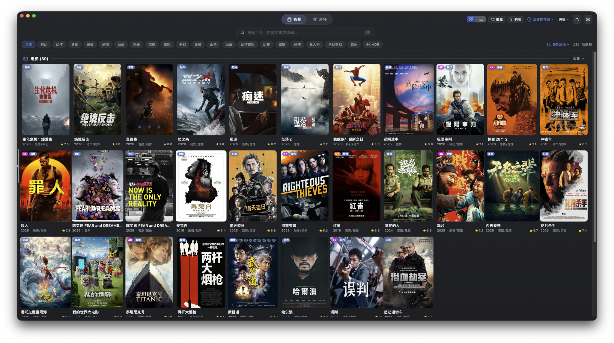
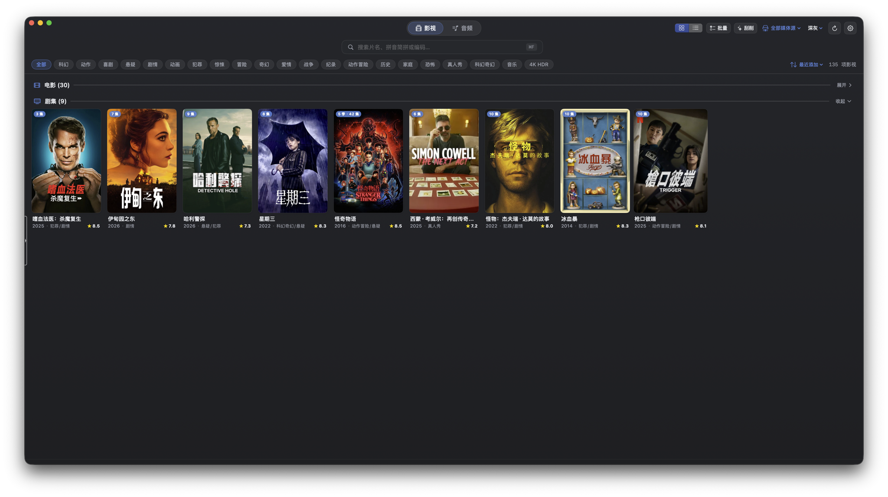
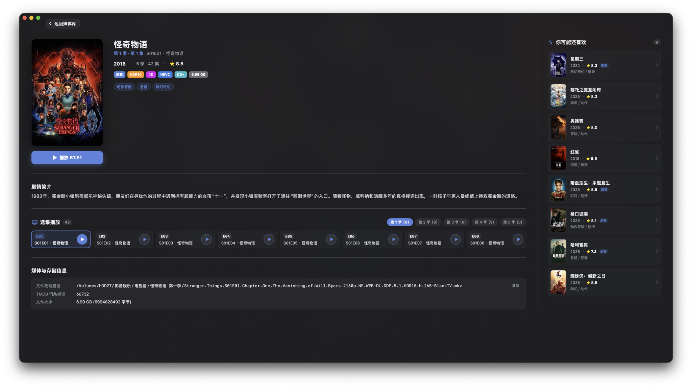
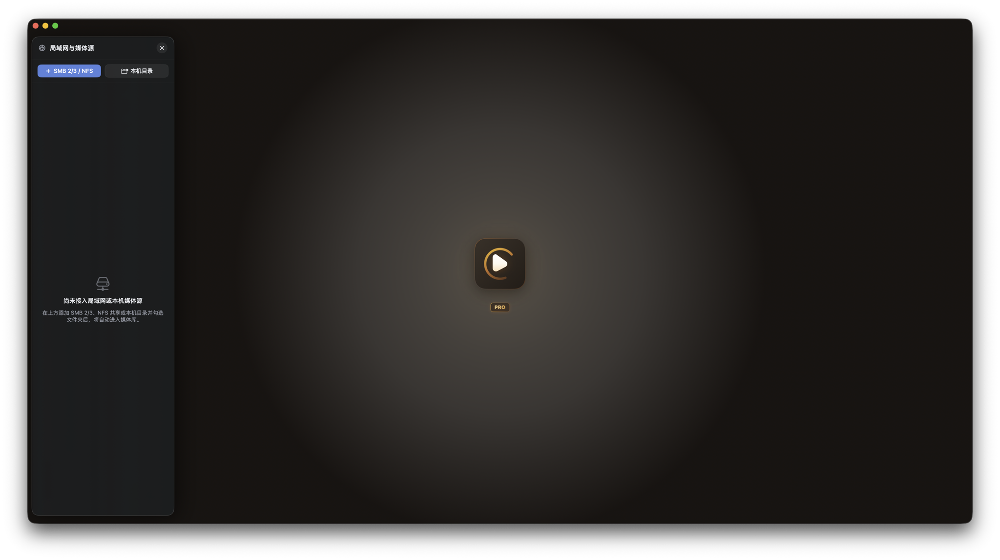
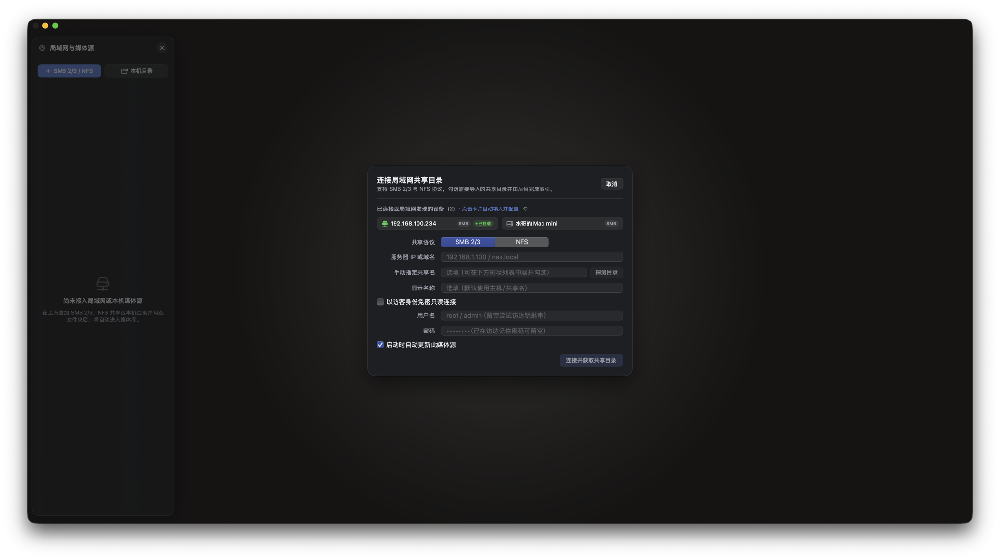
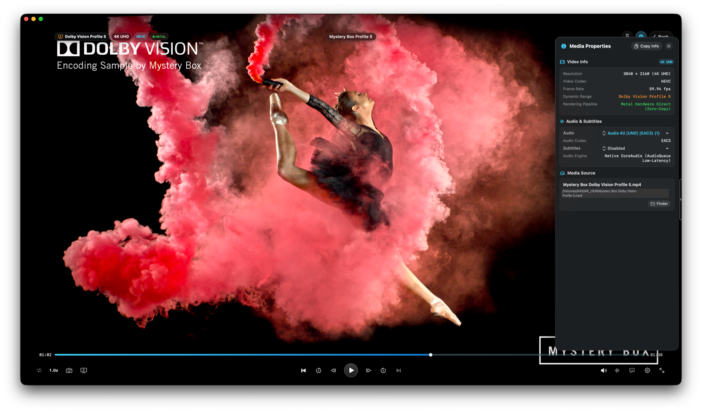
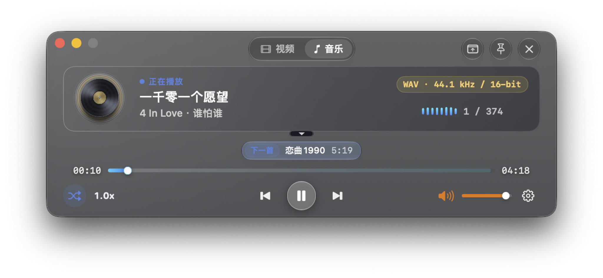
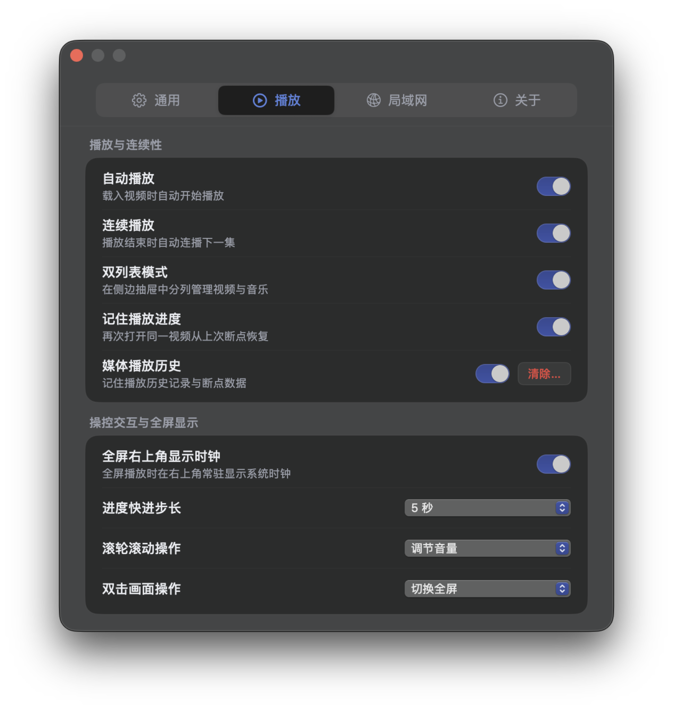

<div align="center">


# SilkPlayer Pro

<p>
  <b>专为 macOS 打造的高端原生影视媒体库与全能播放器。</b><br>
  <b>The premier native media library and cinema player crafted for macOS.</b><br>
  极致流畅的 4K/8K 画质还原、自动整理的私人影视海报墙、独立的黑胶音乐视窗，纯粹且纯净。<br>
  Ultra-smooth 4K/8K playback, automated cinema poster wall, and standalone vinyl music mode.
</p>

<p>
  <a href="https://www.apple.com/macos/"></a>
  <a href="https://www.apple.com/mac/"></a>
  <a href="https://swift.org"></a>
  <a href="scripts/run_tests.sh"></a>
  <a href="LICENSE"></a>
  <a href="https://silkplayer.com"></a>
</p>

<br>



<br>
<sub><em>SilkPlayer Pro · macOS 原生架构 · 本地、外置硬盘与 NAS 海报墙 · 杜比视界高动态色彩呈现</em></sub><br>
<sub><em>Native macOS Architecture · Local, External Drive &amp; NAS Poster Wall · Dolby Vision High-Dynamic-Range Playback</em></sub>

</div>

<br>

---

### 产品概述 / Product Overview

> **把播放器还给电影，把时间留给享受 / Give the player back to movies, give your time back to enjoyment.**  
> 告别复杂晦涩的解码参数与臃肿卡顿的跨平台界面，带来开箱即用的通透画质、整洁海报墙与纯净原生的 Mac 体验。  
> Leave behind confusing codec settings and sluggish cross-platform wrappers. SilkPlayer Pro delivers stunning visuals, an automated cinema poster wall, and a pure native Mac experience out of the box.

在 Mac 上看电影或听音乐，本该是一件轻松愉悦的事。然而许多传统播放器随着版本迭代，积累了大量令人望而生畏的技术设置、不统一的弹窗与繁重的系统负担。  
SilkPlayer Pro 坚守原生 Mac 软件的高标准：启动即开、拖入即播、画质通透、界面克制。没有 NAS 也能使用完整媒体库——无论是存放在 Mac 本机文件夹、外置移动硬盘里的高清电影，还是家庭网络存储设备中的海量剧集，都可以自动整理成海报墙，双击即播。

Watching movies and listening to music on your Mac should be effortless and delightful. Yet many traditional players have become cluttered with complex configuration menus, disjointed dialogs, and heavy system overhead.  
SilkPlayer Pro upholds the finest traditions of native Mac software: instant startup, drop-to-play simplicity, vivid color fidelity, and restrained design. No NAS required—whether your media sits in local Mac folders, on external USB/Thunderbolt drives, or across home network shares, SilkPlayer Pro organizes everything into a clean poster wall ready from the first click.

---

### 核心功能与实机全景 / Feature Highlights & Visual Tour

> 采用**左中右英分栏要点 + 对应实机界面直览**，按 4 大核心场景编排；全部功能要点均配有实机截图对照。  
> Organized into 4 core scenarios with **side-by-side bilingual highlights** paired directly with live application screenshots.

---

#### 1. 私人影视海报墙与全源媒体库 / Cinema Poster Wall & Media Library

<table>
  <tr>
    <th width="50%" align="left">中文特性说明</th>
    <th width="50%" align="left">English Highlights</th>
  </tr>
  <tr>
    <td width="50%" valign="top">
      <ul>
        <li><b>全源一体接入</b>：无需 NAS 即可直接添加 Mac 本机目录与外置硬盘；同时支持局域网自动发现群晖、威联通、TrueNAS、Windows SMB/NFS 共享，免去访达手动挂载。</li>
        <li><b>自动刮削海报墙</b>：自动识别元数据并匹配海报、背景图、演职员阵容与剧情简介，将零散目录整理为流媒体式海报墙。</li>
        <li><b>连续剧多季归拢</b>：整季剧集自动聚合，提供结构化分集大网格与单集断点续播记忆。</li>
        <li><b>双栏电影详情页</b>：立体投影海报搭配柔和背景环境光，直观展示 4K、HDR、杜比视界、声道与文件体积标签。</li>
        <li><b>相似好片推荐</b>：依据当前影片类型与标签，在详情页右侧关联推荐同片库佳作。</li>
        <li><b>高效批量管理</b>：支持一键切换分类、批量重置观看进度与安全防误删移出索引。</li>
      </ul>
    </td>
    <td width="50%" valign="top">
      <ul>
        <li><b>Local, External &amp; LAN Sources</b>: Add local Mac folders or external drives without a NAS, or auto-discover LAN SMB/NFS shares (Synology, QNAP, TrueNAS, Windows) without manual Finder mounting.</li>
        <li><b>Automated Poster Wall</b>: Scrapes artwork, backdrops, cast info, and plot summaries to turn raw folders into a structured cinema wall.</li>
        <li><b>Multi-Season Series Grid</b>: Groups TV seasons automatically with an episode grid drawer and per-episode resume checkpoints.</li>
        <li><b>Two-Column Movie Detail</b>: 3D drop-shadow posters and ambient backdrop lighting with clear badges for 4K, HDR, Dolby Vision, audio channels, and file size.</li>
        <li><b>Contextual Recommendations</b>: Suggests related titles from your own library beside the movie details based on genres and tags.</li>
        <li><b>Batch Library Management</b>: Switch categories, reset watch progress in bulk, and remove entries with trash-safe confirmation.</li>
      </ul>
    </td>
  </tr>
</table>

<table>
  <tr>
    <td width="50%" align="center"><b>01. 影视海报墙全景（本地 / 外置硬盘 / NAS）<br>Media Library Poster Wall (Local, External &amp; NAS)</b></td>
    <td width="50%" align="center"><b>02. 多源全量聚合与影视分类管理<br>Multi-Source Aggregation &amp; Categories</b></td>
  </tr>
  <tr>
    <td align="center"></td>
    <td align="center"></td>
  </tr>
  <tr>
    <td align="center"><sub>自适应海报网格，悬停单点快捷播放，支持快速移出继续观看<br>Adaptive poster grid with hover-to-play and quick watchlist pruning</sub></td>
    <td align="center"><sub>全部媒体源下拉切换、电影与剧集分流、顶部栏快速筛选<br>Dropdown source switcher, movie/series split, and top-bar filtering</sub></td>
  </tr>
  <tr>
    <td width="50%" align="center"><b>03. 电影沉浸详情页与 4K 杜比视界规格标签<br>Movie Detail View &amp; Technical Badges</b></td>
    <td width="50%" align="center"><b>04. 连续剧分季选集大网格与相似好片推荐<br>TV Series Multi-Season Grid &amp; Recommendations</b></td>
  </tr>
  <tr>
    <td align="center"></td>
    <td align="center"></td>
  </tr>
  <tr>
    <td align="center"><sub>背景环境光、立体海报投影、剧情简介与实测音画规格标签<br>Ambient glow, 3D poster shadow, synopsis, and probed media badges</sub></td>
    <td align="center"><sub>分季选集抽屉与逐集断点记忆，右侧联动推荐相似影片<br>Multi-season episode drawer with resume state and related picks</sub></td>
  </tr>
  <tr>
    <td width="50%" align="center"><b>10. 媒体库初始页面与极简接入向导<br>Library Welcome &amp; Onboarding Guide</b></td>
    <td width="50%" align="center"><b>11. 本地目录与网络存储接入引导<br>Local Folder &amp; LAN Storage Guide</b></td>
  </tr>
  <tr>
    <td align="center"></td>
    <td align="center"></td>
  </tr>
  <tr>
    <td width="50%" align="center"><b>12. 局域网设备全自动扫描发现列表<br>Automatic LAN Storage Device Discovery List</b></td>
    <td width="50%" align="center"><b>13. 远程共享服务连接与多目录勾选<br>Remote Share Authentication &amp; Folder Selection</b></td>
  </tr>
  <tr>
    <td align="center"></td>
    <td align="center"></td>
  </tr>
  <tr>
    <td colspan="2" align="center"><sub>支持直接勾选本机与外置硬盘目录，或自动扫描局域网共享服务，免访达挂载一键建库<br>Select Mac local/external folders directly or auto-discover LAN shares without Finder mounting</sub></td>
  </tr>
</table>

<br>

#### 2. 影院级 4K/8K 与杜比视界播放 / Master-Grade Cinema Playback

<table>
  <tr>
    <th width="50%" align="left">中文特性说明</th>
    <th width="50%" align="left">English Highlights</th>
  </tr>
  <tr>
    <td width="50%" valign="top">
      <ul>
        <li><b>4K / 8K 高码率直出</b>：硬件加速直通解码，拖拽时间轴即时响应，长时间观影低功耗低发热。</li>
        <li><b>杜比视界与 HDR 色彩还原</b>：充分发挥 Mac 屏幕高动态范围能力，暗部层次清晰、高光通透不过曝，避免画面发白偏色。</li>
        <li><b>黑边环境光柔化（Pro 可选）</b>：宽银幕留白黑边可选开启柔和延展微光，兼顾沉浸感与边缘视觉过渡。</li>
        <li><b>全格式封装直读</b>：原生支持 MP4、MKV、MOV、FLV、TS、WebM、AVI 等主流及专业封装，无需转码。</li>
        <li><b>纯透明悬浮播控栏</b>：无底部实心黑框，播放时自动渐隐退场，保持完整观影视野。</li>
        <li><b>时间轴悬停预览缩略图</b>：光标滑过进度条即时呈现对应画面高清缩略图，快速定位目标片段。</li>
        <li><b>外挂字幕智能关联</b>：自动检索同级与字幕子目录内的 SRT、ASS、VTT 等外挂字幕，也支持拖放即时挂载。</li>
      </ul>
    </td>
    <td width="50%" valign="top">
      <ul>
        <li><b>4K &amp; 8K High-Bitrate Playback</b>: Hardware-accelerated pipeline with instant timeline seeking, low heat, and extended battery life.</li>
        <li><b>Dolby Vision &amp; HDR Fidelity</b>: Unlocks full Mac display dynamic range for deep shadow detail and crisp highlights without washed-out colors.</li>
        <li><b>Ambient Letterbox Fill (Pro Optional)</b>: Optionally fills cinema letterbox/pillarbox margins with a soft ambient glow while keeping video sharp.</li>
        <li><b>Universal Container Support</b>: Plays MP4, MKV, MOV, FLV, TS, WebM, AVI, and professional containers natively with zero transcoding.</li>
        <li><b>Transparent Floating Controls</b>: Minimalist floating HUD with no opaque bars; fades smoothly out of sight during playback.</li>
        <li><b>Timeline Hover Thumbnails</b>: Hover along the scrubber to preview high-resolution frames for precise scene navigation.</li>
        <li><b>Smart Subtitle Matching</b>: Auto-loads SRT, ASS, and VTT files from adjacent or subtitle folders, plus drag-and-drop mounting.</li>
      </ul>
    </td>
  </tr>
</table>

<table>
  <tr>
    <td width="50%" align="center"><b>05. 4K UHD 杜比视界高动态画质直出<br>4K UHD Dolby Vision High-Fidelity Playback</b></td>
    <td width="50%" align="center"><b>06. 纯透明悬浮播控栏与毫秒级进度微调<br>Transparent Floating Scrubber &amp; Controls</b></td>
  </tr>
  <tr>
    <td align="center"></td>
    <td align="center"></td>
  </tr>
  <tr>
    <td align="center"><sub>完整保留暗部细节与高光层次，真实还原 HDR / 杜比视界色彩<br>Preserves shadow depth and specular highlights with accurate HDR / Dolby Vision tone</sub></td>
    <td align="center"><sub>纯透明悬浮播控胶囊，播放时自动隐退，无实心底框遮挡画面<br>Floating pill controls fade away cleanly with zero opaque bottom boxes</sub></td>
  </tr>
  <tr>
    <td colspan="2" align="center"><b>07. 视频规格属性与音画详细信息悬浮面板<br>Live Stream Properties &amp; Video Metadata Overlay</b></td>
  </tr>
  <tr>
    <td colspan="2" align="center"></td>
  </tr>
  <tr>
    <td colspan="2" align="center"><sub>实时查看当前视频的分辨率、帧率、色彩空间、编码格式与音频声道参数<br>Inspect live resolution, frame rate, color space, codec, and audio channel details anytime</sub></td>
  </tr>
</table>

<br>

#### 3. 独立桌面黑胶音乐播放器与无损曲库 / Standalone Vinyl Music Mode &amp; Audio Library

<table>
  <tr>
    <th width="50%" align="left">中文特性说明</th>
    <th width="50%" align="left">English Highlights</th>
  </tr>
  <tr>
    <td width="50%" valign="top">
      <ul>
        <li><b>展开列表与迷你卡片切换</b>：既可展开查看完整队列与曲库信息，也能收拢为桌面角落的极简小卡片，适配多任务分屏。</li>
        <li><b>拟真旋转黑胶视窗</b>：黑胶唱片随旋律平滑旋转，辅以柔和动态光晕，提供专注纯粹的桌面听歌陪伴。</li>
        <li><b>菜单栏常驻随身听</b>：一键收拢至顶部菜单栏，释放 Dock 空间，随时点击切歌与调音。</li>
        <li><b>全格式高解析无损音频</b>：直出 FLAC、APE、WAV、DSD、DTS 等无损音频，人声与声场通透还原。</li>
        <li><b>多声道平衡与防破音保护</b>：自动平衡多声道音轨输出至耳机或双声道音箱，保障对白清晰、大动态不削波失真。</li>
      </ul>
    </td>
    <td width="50%" valign="top">
      <ul>
        <li><b>Expanded Queue &amp; Mini Card</b>: Switch smoothly between a full playlist view and an ultra-compact desktop card for multitasking.</li>
        <li><b>Rotating Vinyl Visualizer</b>: Realistic spinning vinyl disc paired with gentle ambient glow for focused listening sessions.</li>
        <li><b>Menu Bar Micro-Player</b>: Minimize directly to the macOS menu bar to keep your Dock tidy with one-click track controls.</li>
        <li><b>Lossless Audio Playback</b>: Faithfully decodes FLAC, APE, WAV, DSD, and DTS studio-grade formats with clean detail.</li>
        <li><b>Smart Balance &amp; Protection</b>: Balances multichannel tracks for headphones and stereo speakers, keeping dialog crisp without clipping.</li>
      </ul>
    </td>
  </tr>
</table>

<table>
  <tr>
    <td width="50%" align="center"><b>08. 独立音乐播放器：展开模式与黑胶旋转视窗<br>Music Mode: Expanded Queue &amp; Vinyl Visualizer</b></td>
    <td width="50%" align="center"><b>09. 独立音乐播放器：极简桌面伴侣小卡片<br>Music Mode: Minimal Desktop Companion Card</b></td>
  </tr>
  <tr>
    <td align="center"></td>
    <td align="center"></td>
  </tr>
  <tr>
    <td align="center"><sub>拟真黑胶旋转视窗与动态光晕，支持一键收拢至菜单栏常驻<br>Rotating vinyl disc with dynamic glow and menu bar minimization</sub></td>
    <td align="center"><sub>紧凑桌面伴侣卡片，清晰呈现专辑封面与快捷播控按钮<br>Compact desk companion card with album artwork and quick controls</sub></td>
  </tr>
  <tr>
    <td colspan="2" align="center"><b>14. 本地无损音频曲库一体化管理<br>Local Lossless Audio Track Library Management</b></td>
  </tr>
  <tr>
    <td colspan="2" align="center"></td>
  </tr>
  <tr>
    <td colspan="2" align="center"><sub>集中管理本地无损曲目，支持按歌手、专辑与曲目快速检索定位<br>Centralized lossless track management with instant artist, album, and song search</sub></td>
  </tr>
</table>

<br>

#### 4. 纯正 Mac 原生质感与极简设置 / Pure Native Mac Craftsmanship &amp; Preferences

<table>
  <tr>
    <th width="50%" align="left">中文特性说明</th>
    <th width="50%" align="left">English Highlights</th>
  </tr>
  <tr>
    <td width="50%" valign="top">
      <ul>
        <li><b>4 款高品质主题全局联动</b>：内置经典深灰、深邃黑（OLED 纯黑）、钛金灰与冰霜白主题，全局视窗同步切换。</li>
        <li><b>多设备观影进度随行</b>：支持跨 Mac 设备同步播放进度，换一台设备即可从上次断点无缝续播。</li>
        <li><b>播放列表拼音与文本快搜</b>：支持汉字与拼音首字母秒级过滤海量剧集分集与音频曲目。</li>
        <li><b>极低占用与零后台常驻</b>：静态浏览维持极低 CPU/GPU 消耗，退出即彻底释放内存，无常驻守护进程。</li>
        <li><b>一屏无滚动偏好设置</b>：信息架构紧凑清晰，全部核心设置一屏直达，告别多层嵌套翻找。</li>
      </ul>
    </td>
    <td width="50%" valign="top">
      <ul>
        <li><b>4 Curated Global Themes</b>: Switch seamlessly across Classic Dark, Deep Onyx (OLED), Titanium Gray, and Frost White across every window.</li>
        <li><b>Multi-Device Watch Sync</b>: Keeps playback checkpoints synced across multiple Macs so you can resume right where you left off.</li>
        <li><b>Pinyin &amp; Keyword Search</b>: Filter large episode lists and audio queues instantly by Chinese Pinyin initials or text keywords.</li>
        <li><b>Low Footprint, Zero Daemons</b>: Minimal idle CPU/GPU overhead and complete memory release on quit with no background agents.</li>
        <li><b>Single-Screen Preferences</b>: Clean, non-scrolling layout puts all essential settings within immediate reach.</li>
      </ul>
    </td>
  </tr>
</table>

<table>
  <tr>
    <td width="50%" align="center"><b>15. 通用设置：外观与 4 款高品质主题切换<br>General Settings: Appearance &amp; 4 Curated Themes</b></td>
    <td width="50%" align="center"><b>16. 播放与连续性设置：紧凑零滚动布局<br>Playback Settings: Compact Zero-Scrolling Layout</b></td>
  </tr>
  <tr>
    <td align="center"></td>
    <td align="center"></td>
  </tr>
  <tr>
    <td width="50%" align="center"><b>17. 媒体库设置：本地、外置硬盘、局域网与同步控制<br>Library Settings: Local, External, LAN &amp; Sync Control</b></td>
    <td width="50%" align="center"><b>18. 关于面板：SilkPlayer Pro 软件信息与规格<br>About Panel: SilkPlayer Pro Specs &amp; Licensing</b></td>
  </tr>
  <tr>
    <td align="center"></td>
    <td align="center"></td>
  </tr>
  <tr>
    <td colspan="2" align="center"><sub>精心微调的设置面板，所有选项一屏尽览无纵向滚动条，4 款主题全局同步所有视窗<br>Refined preference panes eliminate vertical scrolling while four themes sync across all windows</sub></td>
  </tr>
</table>

---

### 系统运行要求 / System Requirements

* **操作系统 / OS**: macOS 14.0 (Sonoma) 或 / or macOS 15.0+ (Sequoia)
* **硬件平台 / Architecture**: Universal 通用二进制架构（原生支持 Apple Silicon M1-M6 全系列芯片与 Intel 64 位处理器）/ Universal Binary natively supporting Apple Silicon (M1-M6) and Intel 64-bit Macs
* **显示支持 / Display**: 支持标准显示器、Retina 视网膜屏幕与 Pro Display XDR 等高动态范围显示设备 / Standard, Retina, and HDR/EDR displays supported

---

### 获取与安装 / Download &amp; Installation

#### 方式一：官方全球高速直连下载 / Option 1: Direct Edge Download (Recommended)

直接从官方全球网络高速下载最新通用安装镜像（满速秒下，无任何跳转与拦截）：  
Download the latest universal disk image directly from our global network:

* **通用安装镜像 / Universal DMG (Apple Silicon &amp; Intel)**: [SilkPlayer-universal.dmg](https://silkplayer.com/api/download)（安装包体积约 24.0 MiB，精简轻巧 / 24.0 MiB, ultra-compact）

亦可前往 / Alternatively download from [GitHub Releases](https://github.com/meowvia/SilkPlayer/releases/latest)。

#### 方式二：拖拽安装 / Option 2: Drag-and-Drop Installation

1. 双击打开 `SilkPlayer-2.2.0-universal.dmg`；  
   Open `SilkPlayer-2.2.0-universal.dmg`;
2. 将 `SilkPlayer.app` 图标拖入右侧的 `Applications`（应用程序）文件夹中；  
   Drag `SilkPlayer.app` into your Applications folder;
3. 从启动台（Launchpad）或应用程序目录打开使用。  
   Launch from Applications or Launchpad.

> [!TIP]
> **macOS 首次打开提示 / macOS Gatekeeper Notice**  
> 若系统提示“未验证开发者”或隔离警告（属于开源未公证软件的标准提示），在「应用程序」中按住键盘 `Control` 键并点击应用，选择「打开」即可永久授权信任。  
> If macOS displays an "unidentified developer" or quarantine notice, open your Applications folder in Finder, hold down the `Control` key, click `SilkPlayer.app`, and select `Open` to permanently authorize the application.  
> 亦可在系统「终端」中执行以下单行命令快速放行 / Or run this single command in Terminal:
> ```bash
> sudo xattr -rd com.apple.quarantine /Applications/SilkPlayer.app
> ```

---

### 软件许可与版权声明 / Licensing &amp; Disclaimers

* **开源前端组件 / Open-Source Components**: 前端宿主代码遵循 [GNU Lesser General Public License v3.0 (LGPL-3.0)](LICENSE) 开源协议；  
  Frontend host application components are released under the GNU Lesser General Public License v3.0 (LGPL-3.0).
* **商业核心与高级功能 / Proprietary Core &amp; Pro Features**: 受专有许可协议 [SILKCOREKIT_LICENSE.md](SILKCOREKIT_LICENSE.md) 保护，个人非商业用途可自由体验。  
  Protected under the dedicated license agreement [SILKCOREKIT_LICENSE.md](SILKCOREKIT_LICENSE.md) for personal, non-commercial evaluation.

#### 商标与影视资产免责声明 / Trademark &amp; Media Disclaimers
* **商标归属 / Trademarks**: Apple、macOS、Apple Silicon、MacBook、Retina 与 Finder 均为 Apple Inc. 的注册商标；Dolby 与 Dolby Vision 均为杜比实验室（Dolby Laboratories）的注册商标；SilkPlayer Pro 为独立软件项目，与上述实体无附属或代言关系。  
  Apple, macOS, Apple Silicon, MacBook, Retina, and Finder are trademarks of Apple Inc. Dolby and Dolby Vision are trademarks of Dolby Laboratories. SilkPlayer Pro is an independent software project with no affiliation or endorsement.
* **影视素材说明 / Media Assets Notice**: 截图中出现的影视海报、元数据、剧照与商标仅用于软件界面效果的功能性演示，其版权归各自制片方或权利人所有。SilkPlayer Pro 本身不内置、不提供、亦不分发任何受版权保护的多媒体内容。  
  All posters, metadata, movie stills, and trademarks depicted in screenshots are the property of their respective copyright owners and are utilized strictly for functional software demonstration. SilkPlayer Pro does not host, bundle, or distribute any copyrighted media.
