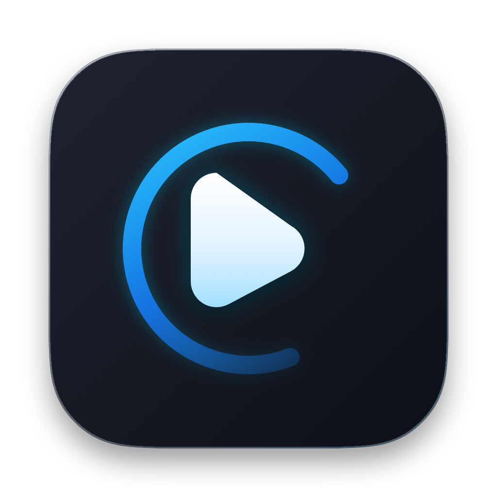
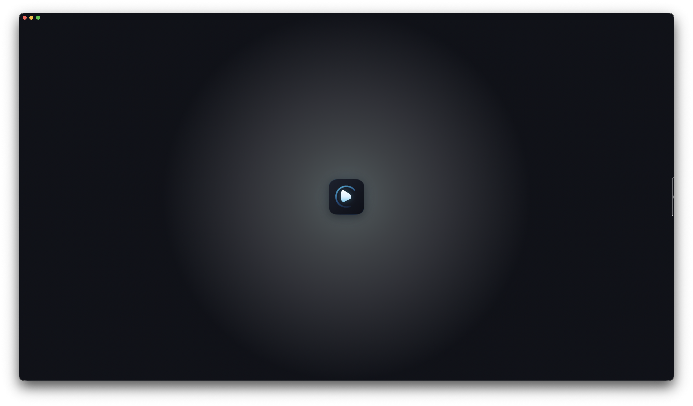
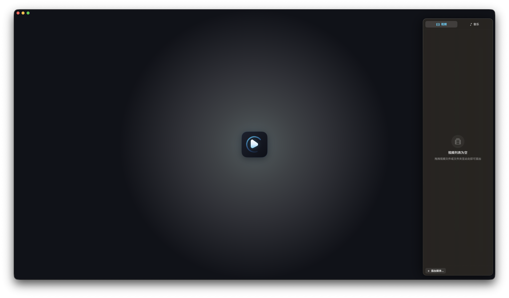
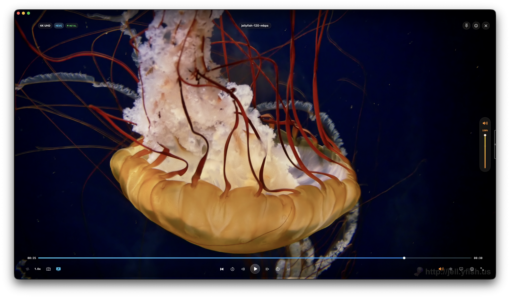
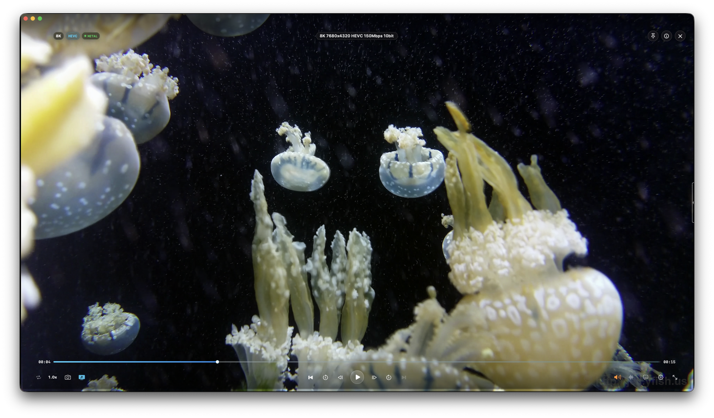
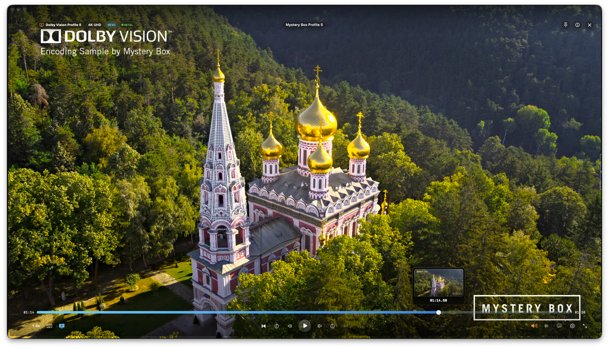
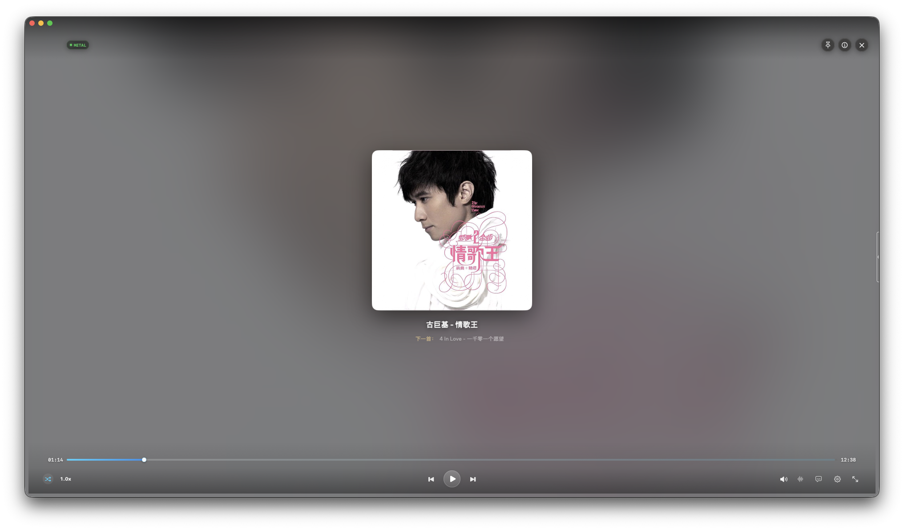
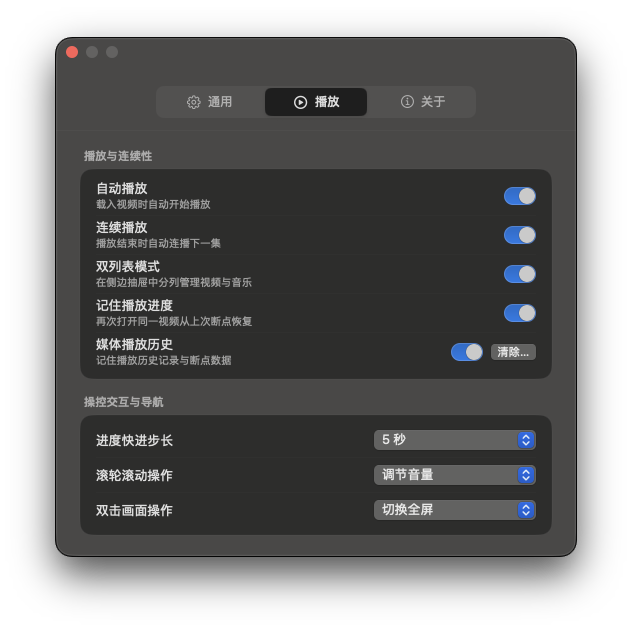
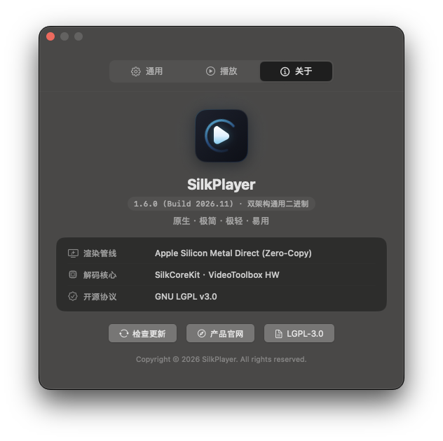

<div align="center">



# SilkPlayer

**A lightweight, native media player crafted for macOS.**  
Dedicated to lightweight performance, speed, ease of use, and a pure local viewing experience.

[](https://www.apple.com/macos/)
[](https://www.apple.com/mac/)
[](https://swift.org)
[](scripts/run_tests.sh)
[](LICENSE)

[**English**](README.md) · [**简体中文**](README_CN.md)

<br />

<!-- Main Product Preview -->

<br />
<sub><em>Minimalist borderless design · Drag and drop video files or click the center logo to start</em></sub>

</div>

---

## Product Overview

On macOS, many mature local media players offer extensive capabilities. However, over time they often accumulate complex menus and obscure configuration switches, turning what should be an instant viewing experience into a cumbersome setup process.

SilkPlayer's philosophy is simple: native, lightweight, and effortless. We eliminate tedious parameters by enabling hardware decoding, accurate color rendering, and intuitive playback controls by default—allowing you to open a video and start watching immediately.

---

## Architecture & Engineering

SilkPlayer uses zero web-wrapper or cross-platform shells, built entirely on Apple's native technology stack:

1. **Native macOS Development**: Built with a hybrid of SwiftUI and AppKit, avoiding Electron or Chromium overhead. Strictly following Apple's Human Interface Guidelines (HIG), Dark Mode, vibrant materials, and window management are driven directly by native system APIs.
2. **Swift 6 Strict Concurrency**: Fully adhering to Swift 6 specifications and modern structured concurrency. UI rendering, playback engine control, and file I/O enforce strict `@MainActor` isolation and Sendable boundaries, preventing multi-threaded data races at compile time and ensuring long-term playback stability.
3. **Metal-Driven HDR & Dolby Vision Tone Mapping**: Powered by an Apple Metal graphics pipeline for hardware tone mapping of Dolby Vision Profile 5 and standard HDR10 content. Dynamic soft-knee rolloff adapts to display EDR Headroom in real time, delivering expansive dynamic range while preventing highlight blowout.
4. **On-Demand Timeline Thumbnail Scrubbing**: An on-demand frame indexing and caching mechanism generates preview thumbnails only when the mouse hovers over the progress bar, avoiding upfront decoding of the entire video and eliminating unnecessary disk and memory overhead.
5. **System Resource Management**: Free from cross-platform background processes, decoding and rendering memory buffers are allocated dynamically on demand and promptly reclaimed upon playback stop, keeping CPU usage, heat, and battery drain minimal on MacBooks.

---

## Key Features

1. **Universal Codec Support**: Powered by FFmpeg optimized for macOS, supporting MP4, MKV, MOV, FLV, TS, WebM, AVI containers, with seamless hardware decoding for H.264, HEVC (H.265), AV1, VP9, and ProRes up to 4K and 8K resolutions.
2. **HDR10 & Dolby Vision**: Native support for HDR10 and Dolby Vision (Profile 5, Profile 8, etc.), adapting to the display's actual dynamic range to render faithful highlights and deep shadow details.
3. **Timeline Hover Preview**: Hovering over the scrubber displays instant high-resolution frame thumbnails with precise timestamps for effortless navigation.
4. **Chapter Marks & Navigation**: Automatically detects embedded video chapters, displaying chapter markers on the timeline for quick skipping.
5. **Image Enhancement & Debanding**: Built-in debanding filter to eliminate gradient color banding, accompanied by real-time controls for brightness, contrast, saturation, and sharpening.
6. **Frame Stepping & Custom Skip Intervals**: Keyboard shortcuts (`[` and `]`) for frame-by-frame forward and backward stepping, alongside customizable fast-forward and rewind second intervals.
7. **Dual Playlists & Vinyl Music Mode**: Dual-track queue separating TV series (sorted with natural semantic ordering) and standalone films; audio files (FLAC, APE, WAV, MP3) automatically collapse into a compact square window with embedded cover art and dynamic vinyl disc rotation.
8. **Intelligent Filename Cleansing**: Automatically strips release group tags, resolutions, codecs, and redundant suffixes to extract clean show titles and episode numbers in the playlist (raw filenames accessible on hover).
9. **Rotation & Mirror Flip**: Quick 90°, 180°, and 270° clockwise video rotation, plus horizontal mirror flipping (ideal for dance tutorials, athletic training, and flipped camera footage).
10. **External Subtitles & Multi-Track Audio**: Automatically loads matched external subtitles (SRT, ASS/SSA, VTT), preserving complex ASS styling and animations; instant switching across multi-language audio tracks with millisecond-level audio/subtitle sync offset adjustment.
11. **Auto-Hiding Immersive Controls**: Designed in strict accordance with macOS HIG, floating borderless timeline and playback controls smoothly fade away during inactivity, leaving an unobstructed cinematic canvas.

---

## Preview Gallery

<div align="center">

### 1. Minimalist Canvas & Dual Playlist Drawer

| Distraction-Free Startup Canvas | Dual Playlist Drawer with Smart Cleansing |
| :---: | :---: |
|  |  |
| *Clean borderless startup canvas; drag files in or click the center logo to start* | *Dual-track queue separating TV series and movies with automatic filename noise cleansing* |

<br />

### 2. High-Bitrate Playback (SilkPlayback Engine · 4K UHD & 8K 150Mbps)

| 4K UHD Playback & Volume Boost HUD | 8K 7680×4320 Decoding Stress Test |
| :---: | :---: |
|  |  |
| *Smooth 4K UHD playback with up to 200% software volume boost and real-time top HUD feedback* | *Stress test with 8K 7680×4320 150Mbps media, demonstrating high-efficiency hardware decoding* |

<br />

### 3. Dolby Vision & Vinyl Music Mode (SilkRender & SilkThumb)

| Dolby Vision Profile 5 & Timeline Scrubbing | Compact Square Vinyl Music Mode |
| :---: | :---: |
|  |  |
| *Dynamic tone mapping for Dolby Vision Profile 5 with instant timeline hover thumbnails* | *Audio files collapse into a compact square window with embedded cover art and dynamic vinyl rotation* |

<br />

### 4. Preferences & Technical Specifications

| Minimalist Playback Preferences | Technical Specifications & SilkCoreKit |
| :---: | :---: |
|  |  |
| *Native preferences panel offering clean shortcuts, skip intervals, and image adjustment toggles* | *About panel detailing version specifications, three proprietary core engines, and licensing compliance* |

</div>

---

## About Core Framework (SilkCoreKit)

SilkPlayer's frontend and interface are completely open-source and free for everyone. The core playback, rendering, and scrubbing subsystems are modularized in a binary framework: `SilkCoreKit`.

SilkCoreKit represents a significant investment of spare time and effort in debugging and performance tuning. To preserve architectural stability, it remains in continuous testing and refinement, and is currently distributed as a closed-source binary. As the project matures, we may consider open-sourcing components in phases or offering licenses.

---

## System Requirements

- **Operating System**: macOS 14.0 (Sonoma) or macOS 15.0+ (Sequoia) *(Legacy macOS 12 Monterey compatibility build available in Releases)*
- **Architecture**: Universal support for Apple Silicon (M-series) & Intel (x86_64) Macs

---

## Installation & Quick Start

### Option 1: Install via Homebrew (Recommended)
```bash
brew install --cask meowvia/tap/silkplayer
```

### Option 2: Download DMG Installer
1. Download the installer matching your Mac's architecture from the [Releases](https://github.com/meowvia/SilkPlayer/releases) page:
   - **Apple Silicon (M1/M2/M3/M4)**: `SilkPlayer-1.5.1-arm64-fix.dmg` (or Universal build)
   - **Intel Mac (x86_64)**: `SilkPlayer-1.5.1-x86_64-fix.dmg`
2. Open the disk image and drag **SilkPlayer.app** to your **Applications** folder;
3. **If macOS warns "App is damaged" or "Unidentified Developer"** (standard Gatekeeper behavior for non-notarized open-source software), run this single command in Terminal:
   ```bash
   xattr -cr /Applications/SilkPlayer.app
   ```
   *(Or navigate to macOS System Settings ➔ Privacy & Security ➔ click "Open Anyway")*

---

### Build from Source
If you prefer to compile SilkPlayer yourself:
```bash
git clone https://github.com/meowvia/SilkPlayer.git
cd SilkPlayer

# Run automated tests
./scripts/run_tests.sh

# Package release DMG
./scripts/package_app.sh 1.6.0 universal
```

> **Build Notes**:
> - FFmpeg core multimedia libraries are provided as dynamic frameworks (LGPL-3.0) directly under `Packages/`.
> - The core playback and rendering engine `SilkCoreKit` is an isolated binary library (statically linked), fetched automatically as a precompiled XCFramework zip archive from GitHub Releases by SwiftPM during `swift build` or packaging. Local contributors can also supply an in-tree build at `Packages/SilkCoreKit.xcframework` per [CONTRIBUTING.md](CONTRIBUTING.md).

---

## Project Status & Future Vision

SilkPlayer is an independent media player developed in spare time. Keeping resource usage exceptionally low while maintaining solid stability has always been a core ambition of this project; clear optimization paths are actively being pursued with the aim of rivaling mainstream players.

We promise: SilkPlayer's core local playback features will remain permanently free for all users. If you encounter issues or have ideas for improvement, feel free to open an [Issue](https://github.com/meowvia/SilkPlayer/issues)—we will do our best to follow up in future updates.

---

## Acknowledgements

SilkPlayer gratefully acknowledges the following open-source projects:

- **[FFmpeg](https://ffmpeg.org)** (LGPL-3.0 Dynamic Frameworks)
- **[libplacebo](https://code.videolan.org/videolan/libplacebo)** & **[mpv](https://github.com/mpv-player/mpv)** (LGPL-2.1+, color science & international standard comparison reference)

### Disclaimers
- Apple, macOS, Apple Silicon, Metal, VideoToolbox, AppKit, and SwiftUI are trademarks of Apple Inc.
- Dolby and Dolby Vision are trademarks of Dolby Laboratories.
- SilkPlayer is an independent software project and is not affiliated with or endorsed by Apple Inc. or Dolby Laboratories.

### Architecture & Licensing (Dual-Track License Structure)
- **Host Application (SilkPlayer)**: Released under the [GNU Lesser General Public License v3.0 (LGPL-3.0)](LICENSE) for the open-source frontend.
- **Underlying Multimedia Libraries (FFmpeg)**: Core libraries (Libavcodec, Libavformat, Libavutil, Libswresample, Libswscale) are linked as LGPL-3.0 dynamic frameworks.
- **Core Engine (SilkCoreKit)**: Governed by the dedicated proprietary component agreement [SILKCOREKIT_LICENSE.md](SILKCOREKIT_LICENSE.md), free for personal non-commercial use, physically isolated as a Swift package binary component.
- For detailed upstream dependency and relinking instructions, refer to [THIRD_PARTY.md](Documentation/THIRD_PARTY.md).
