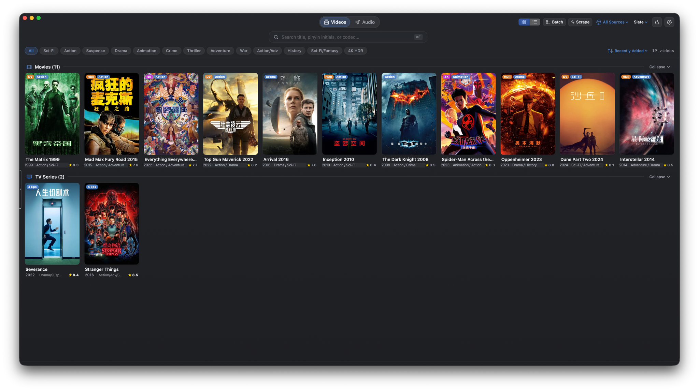
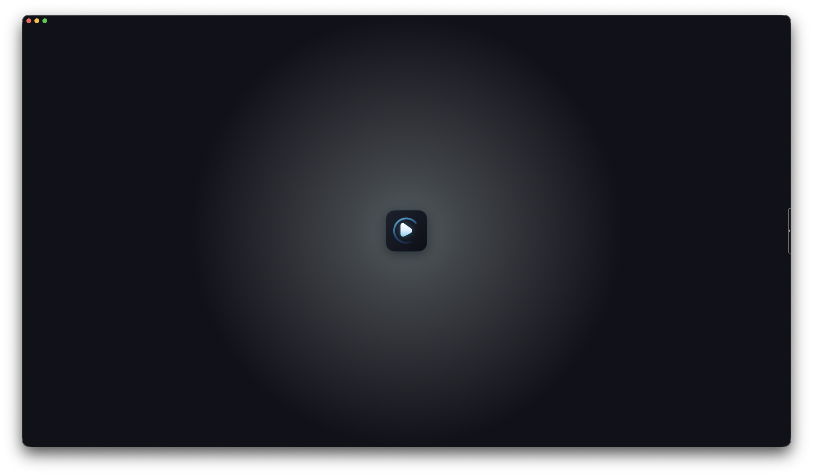
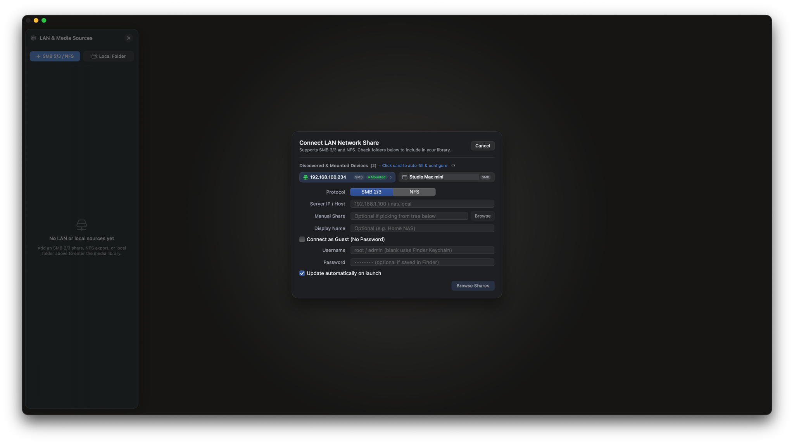
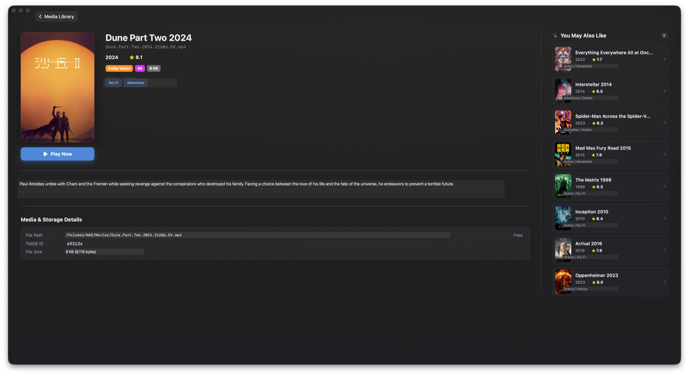
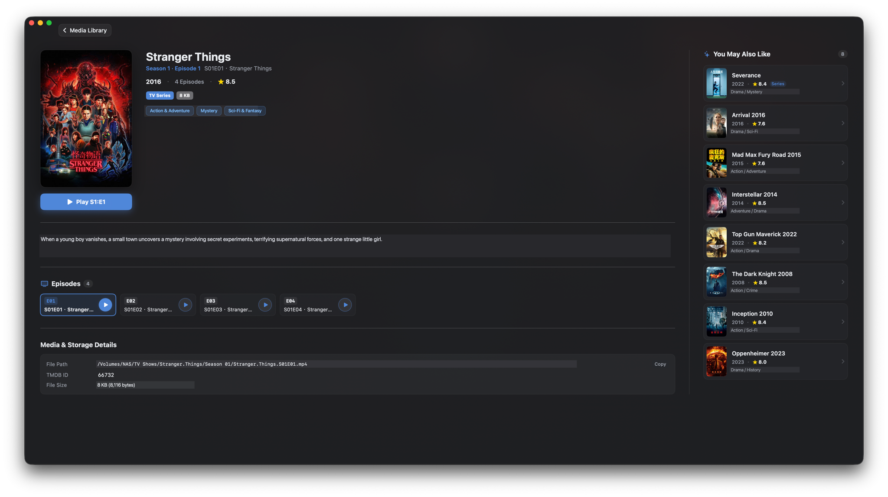
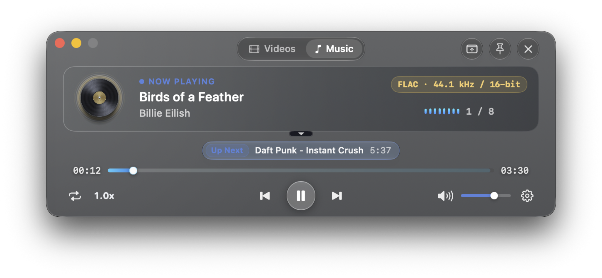
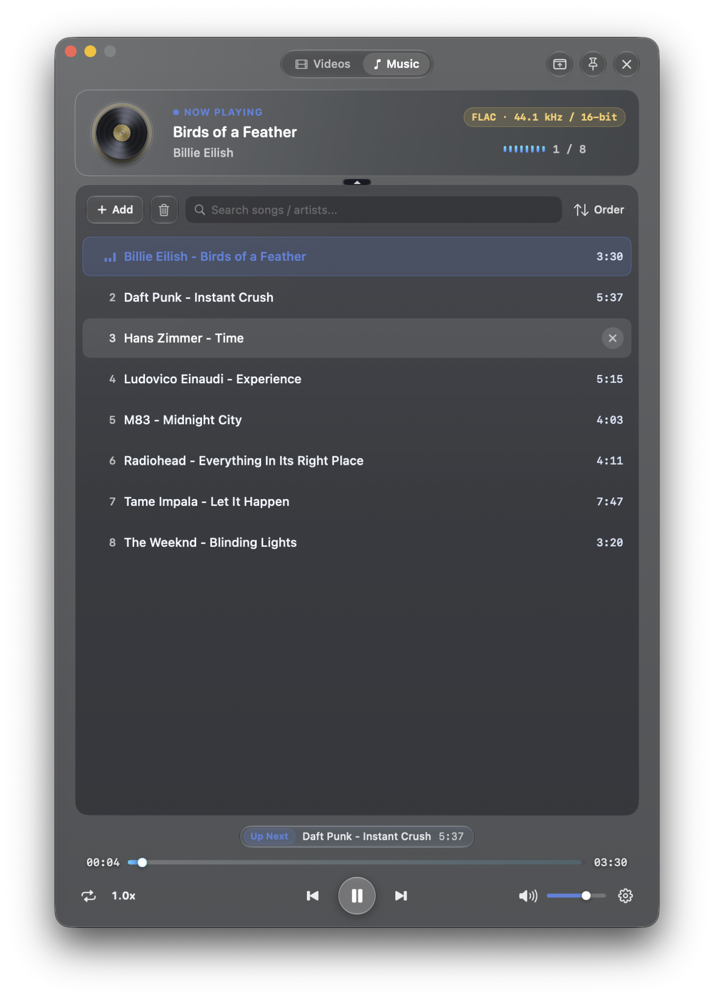
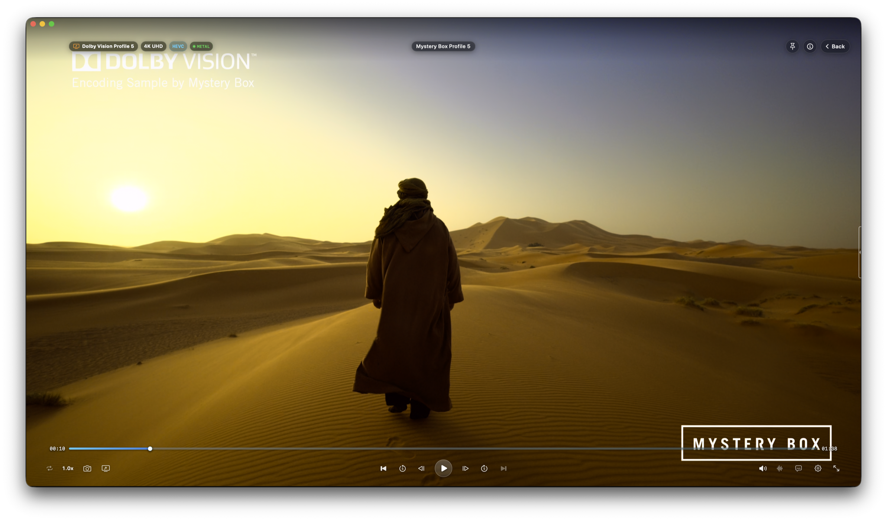
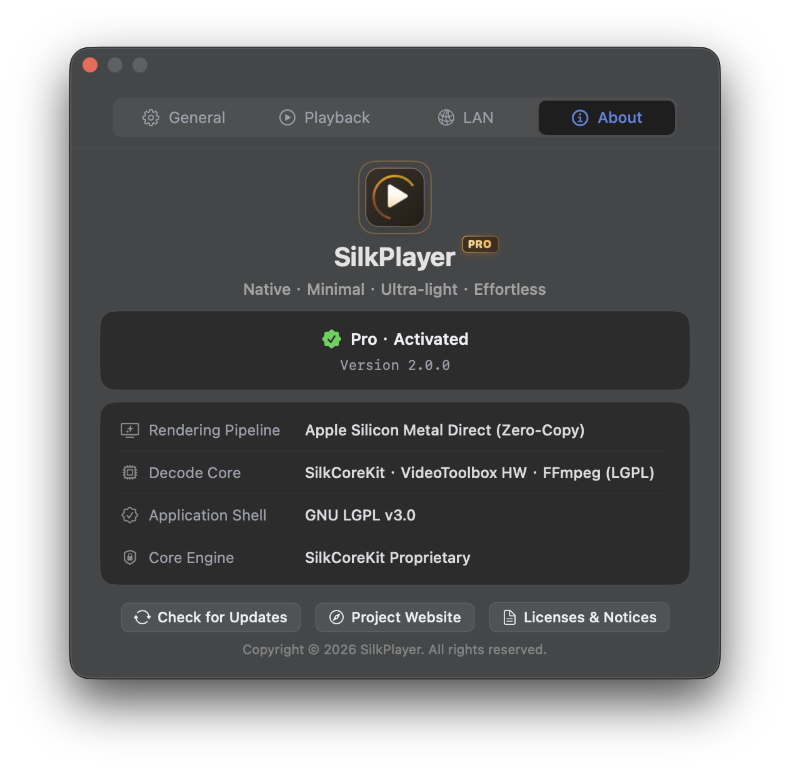

<div align="center">


# SilkPlayer

<p><b>A lightweight, native media player and library crafted for macOS.</b><br>
Engineered for hardware-direct rendering, pure local performance, and zero bloat.</p>

<p>
  <a href="https://www.apple.com/macos/"></a>
  <a href="https://www.apple.com/mac/"></a>
  <a href="https://swift.org"></a>
  <a href="scripts/run_tests.sh"></a>
  <a href="LICENSE"></a>
  <a href="https://silkplayer.1999909.xyz"></a>
</p>

<p>
  <b>English</b> &nbsp;|&nbsp; <a href="README_CN.md">简体中文</a>
</p>

<br>



<br>
<sub><em>SilkPlayer 2.0 · Native macOS Architecture · Local & LAN Poster Wall · Metal HDR Direct Rendering</em></sub>

</div>

<br>

---

### Product Overview

> **Native, lightweight, and effortless.**  
> Built from the ground up to eliminate cross-platform overhead and configuration bloat, delivering hardware decoding, faithful color science, and intuitive media management by default.

Many macOS players accumulate complex configuration menus and conflicting options over time, turning what should be an instantaneous viewing experience into a tedious setup process.

SilkPlayer returns to the fundamentals of macOS software engineering: native speed, minimal memory footprint, and intuitive interaction. Open any video or audio file and start playing immediately without wrestling with codecs or decoder switches.

---

### Key Capabilities in 2.0.0

<table>
  <tr>
    <td width="50%" valign="top">
      <h4>Local & LAN Media Library (Pro)</h4>
      <ul>
        <li><b>Zero-Config Network Auto-Discovery</b><br>Native SMB 2/3 and NFS protocol stacks automatically discover local storage servers without requiring manual Finder volume mounting.</li>
        <li><b>Local .nfo & Edge Metadata Scraping</b><br>Built-in XML engine parses Kodi, Jellyfin, Emby, and TinyMediaManager <code>.nfo</code> files offline, paired with Cloudflare Edge proxying for instant poster lookups.</li>
        <li><b>Two-Column Detail & Recommendations</b><br>Ambient blurred backdrops, 2:3 drop-shadow posters, comprehensive audio/video technical badges, and a multi-factor Jaccard recommendation engine.</li>
        <li><b>Single-Line Header & Batch Operations</b><br>Compact toolbar layout saves 36pt vertical space; batch mode supports multi-item checkpoint resets, index removal, and trash-protected file deletion.</li>
        <li><b>Season Switcher & iCloud Sync Control</b><br>Automatic multi-season series aggregation with side episode drawers and optional iCloud multi-device progress synchronization.</li>
      </ul>
    </td>
    <td width="50%" valign="top">
      <h4>Audio Engine & Music Mode</h4>
      <ul>
        <li><b>Two-Stage Morphing Window (Pro)</b><br>Dedicated music window smoothly toggles between a 188pt minimal card and a 420pt expanded playlist queue, fitting split-screen workflows.</li>
        <li><b>Inertial Vinyl & Acoustic Visualizer (Pro)</b><br>Physics-simulated rotating vinyl disc coupled with a dynamic frequency halo responsive to low, mid, and high audio energy.</li>
        <li><b>Menu Bar Micro-Controller & Zero Dock Footprint (Pro)</b><br>Minimizes into a macOS menu bar resident player, releasing Dock space while retaining instant playback and lyrics access.</li>
        <li><b>Full Lossless Codecs & 5.1/7.1 LPCM</b><br>Native playback for FLAC, APE, WAV, DSD, DTS-CD, and TrueHD; discrete multichannel Float32 LPCM direct output via CoreAudio.</li>
        <li><b>Decoupled Standard Audio Playback (Free)</b><br>Double-click any local audio file to play instantly with 1:1 window snapping and playlist drawer access without paywalls.</li>
      </ul>
    </td>
  </tr>
  <tr>
    <td width="50%" valign="top">
      <h4>Hardware Decoding & Visual Pipeline</h4>
      <ul>
        <li><b>Universal Codec Support</b><br>Powered by macOS-tailored FFmpeg, decoding MP4, MKV, MOV, FLV, TS, WebM, and AVI up to 8K 60fps with native VideoToolbox hardware acceleration.</li>
        <li><b>Metal Zero-Copy Dolby Vision & HDR10</b><br>Direct Metal pipeline tone maps Dolby Vision Profile 5 and HDR10 content to display EDR Headroom in real time with soft-knee highlight roll-off.</li>
        <li><b>Curated 4-Theme Color Matrix (Pro)</b><br>High-contrast Dark Gray, Ice Blue, Warm White, and Celadon themes synchronized across the main window, HUD, library, and Settings.</li>
        <li><b>On-Demand Timeline Thumbnail Scrubbing</b><br>Lazy frame indexing caches preview thumbnails only on scrubber hover, eliminating upfront decoding memory spikes.</li>
      </ul>
    </td>
    <td width="50%" valign="top">
      <h4>Controls & Subtitles (Free)</h4>
      <ul>
        <li><b>Playlist Cmd+F Pinyin Instant Search</b><br>Instant filtering across massive playlists supporting raw text matching and Chinese Pinyin initialisms.</li>
        <li><b>Deep Recursive Subtitle Matching</b><br>Automatically crawls companion folders and <code>Subs/</code>, <code>Subtitles/</code> subdirectories to mount matched external subtitles (SRT, ASS, VTT).</li>
        <li><b>Transparent Cinema Floating HUD</b><br>Minimalist floating pill replaces opaque bottom panels, fading away cleanly during playback.</li>
        <li><b>Soft-Knee Downmixing Limiter</b><br>Smooth limiter prevents audio clipping, crackle, and DAC distortion when downmixing surround sound to stereo.</li>
        <li><b>Adaptive Window Geometry</b><br>Window scales smoothly to video aspect ratios, eliminating pillarbox bars with instant recentering upon exit.</li>
      </ul>
    </td>
  </tr>
</table>

---

### Preview Gallery

#### 1. Core Player Canvas & LAN Share Discovery

<table>
  <tr>
    <td width="50%" align="center"><b>Distraction-Free Startup Canvas</b></td>
    <td width="50%" align="center"><b>Zero-Config SMB 2/3 & NFS Connect</b></td>
  </tr>
  <tr>
    <td align="center"></td>
    <td align="center"></td>
  </tr>
  <tr>
    <td align="center"><sub>Clean borderless startup canvas; drag video files in or click the center logo to start</sub></td>
    <td align="center"><sub>Automatic discovery and mount modal for local SMB 2/3 shares and NFS exports without Finder dependencies</sub></td>
  </tr>
</table>

<br>

#### 2. Immersive Detail View & Smart Recommendations

<table>
  <tr>
    <td width="50%" align="center"><b>Movie Detail Layout & Technical Badges</b></td>
    <td width="50%" align="center"><b>TV Series Detail & Episode Drawer</b></td>
  </tr>
  <tr>
    <td align="center"></td>
    <td align="center"></td>
  </tr>
  <tr>
    <td align="center"><sub>Ambient background glow, 2:3 drop-shadow poster, 4K DV / audio specification badges, and contextual recommendations</sub></td>
    <td align="center"><sub>Structured multi-season episode grid, individual watch progress tracking, and franchise association filters</sub></td>
  </tr>
</table>

<br>

#### 3. Two-Stage Collapsible Music Mode

<table>
  <tr>
    <td width="50%" align="center"><b>Compact Focus Card (188pt)</b></td>
    <td width="50%" align="center"><b>Expanded Playlist Queue & Vinyl (420pt)</b></td>
  </tr>
  <tr>
    <td align="center"></td>
    <td align="center"></td>
  </tr>
  <tr>
    <td align="center"><sub>Ultra-compact desktop card featuring rotating vinyl, track info, and lossless bitrate badges</sub></td>
    <td align="center"><sub>Expanded queue view with inertia-simulated vinyl disc, audio halo visualizer, and menu bar minimization toggle</sub></td>
  </tr>
</table>

<br>

#### 4. High-Bitrate Hardware Playback & Preferences

<table>
  <tr>
    <td width="50%" align="center"><b>Dolby Vision Profile 5 & Transparent HUD</b></td>
    <td width="50%" align="center"><b>Native Preferences & Specifications</b></td>
  </tr>
  <tr>
    <td align="center"></td>
    <td align="center"></td>
  </tr>
  <tr>
    <td align="center"><sub>Hardware-direct 4K UHD HEVC playback with Metal color mapping and clean floating HUD controls</sub></td>
    <td align="center"><sub>Preferences panel with zero-scrolling playback settings, 4-theme visual switcher, and Pro license status</sub></td>
  </tr>
</table>

---

### Architecture & Engineering

SilkPlayer uses zero web-wrapper or cross-platform layers, built entirely on Apple's native technology stack:

* **Swift 6 Strict Concurrency**  
  Fully adhering to Swift 6 specifications and modern structured concurrency. UI rendering, playback engine control, and file I/O enforce strict `@MainActor` isolation and Sendable boundaries, preventing multi-threaded data races at compile time.

* **Metal-Driven HDR & Dolby Vision Tone Mapping**  
  Powered by an Apple Metal graphics pipeline for hardware tone mapping of Dolby Vision Profile 5 and standard HDR10 content. Dynamic soft-knee roll-off adapts to display EDR Headroom in real time, delivering expansive dynamic range while preventing highlight blowout.

* **Resource Footprint Optimization**  
  Poster cache is capped at a strict 250 items / 120MB limit with exact byte accounting. Detail background ambient lighting applies 120px hardware downsampling to cut texture VRAM by 90%. Database connections flush memory on library scans, keeping idle GPU usage at 0% and CPU below 0.5%.

---

### System Requirements

* **Operating System**: macOS 14.0 (Sonoma) or macOS 15.0+ (Sequoia)
* **Architecture**: Universal Binary natively supporting Apple Silicon (M1-M6) and Intel 64-bit Macs
* **Graphics**: Metal hardware acceleration & HDR/EDR display supported

---

### Installation & Quick Start

#### Option 1: Direct Download (Official Global Edge CDN)

Download the latest universal disk image directly from our global edge network (no proxy or VPN required):

* **Universal DMG (Apple Silicon & Intel)**: [SilkPlayer-2.0.0-universal.dmg](https://silkplayer.1999909.xyz/api/download) (22.8 MiB, LZMA compressed)

Alternatively, download from [GitHub Releases](https://github.com/meowvia/SilkPlayer/releases/latest).

#### Option 2: Drag-and-Drop Installation

1. Open `SilkPlayer-2.0.0-universal.dmg`;
2. Drag `SilkPlayer.app` into your `Applications` folder;
3. Launch from Applications or Launchpad.

> [!TIP]
> **macOS Gatekeeper First-Launch Notice**  
> If macOS displays an "unidentified developer" or quarantine notice, open your Applications folder in Finder, hold down the `Control` key, click `SilkPlayer.app`, and select `Open` to permanently authorize the application.  
> Alternatively, run this single command in Terminal:
> ```bash
> sudo xattr -rd com.apple.quarantine /Applications/SilkPlayer.app
> ```

---

### Build from Source

```bash
git clone https://github.com/meowvia/SilkPlayer.git
cd SilkPlayer

# Run automated tests (103 unit tests)
./scripts/run_tests.sh

# Package release DMG
./scripts/package_app.sh 2.0.0 universal
```

> **Build Notes**:
> * FFmpeg core multimedia libraries are provided as dynamic frameworks (LGPL-3.0) under `Packages/`.
> * The core playback and media engine `SilkCoreKit` is an isolated binary component, statically linked via SwiftPM. Local contributors can supply an in-tree build at `Packages/SilkCoreKit.xcframework` per [CONTRIBUTING.md](CONTRIBUTING.md).

---

### Architecture & Licensing (Dual-Track Structure)

* **Host Application (SilkPlayer)**: Released under the [GNU Lesser General Public License v3.0 (LGPL-3.0)](LICENSE) for the open-source frontend.
* **Underlying Multimedia Libraries (FFmpeg)**: Core libraries (Libavcodec, Libavformat, Libavutil, Libswresample, Libswscale) are dynamically linked as LGPL-3.0 frameworks.
* **Core Engine (SilkCoreKit)**: Governed by the dedicated component agreement [SILKCOREKIT_LICENSE.md](SILKCOREKIT_LICENSE.md), physically isolated as a Swift package binary component.

#### Disclaimers
* Apple, macOS, Apple Silicon, Metal, VideoToolbox, AppKit, and SwiftUI are trademarks of Apple Inc.
* Dolby and Dolby Vision are trademarks of Dolby Laboratories.
* SilkPlayer is an independent software project and is not affiliated with or endorsed by Apple Inc. or Dolby Laboratories.
