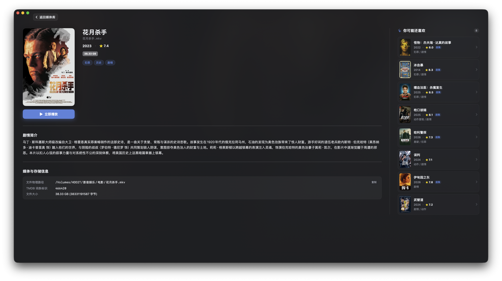
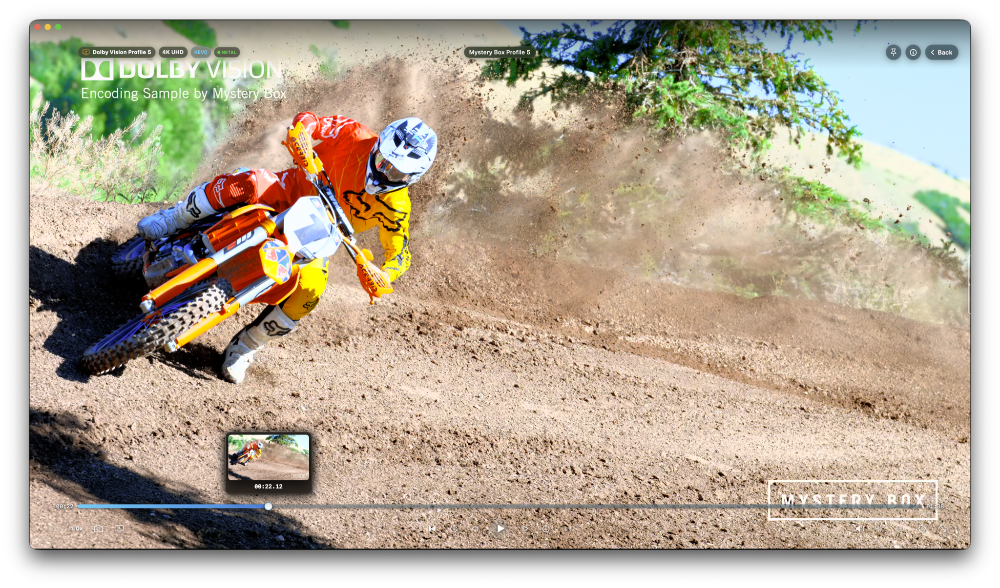
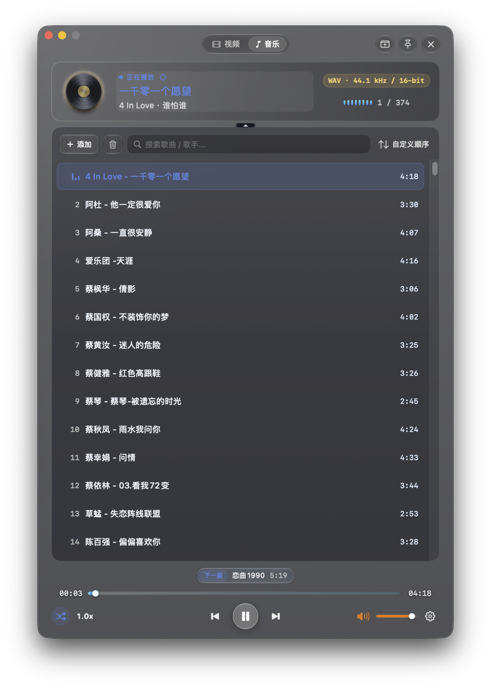
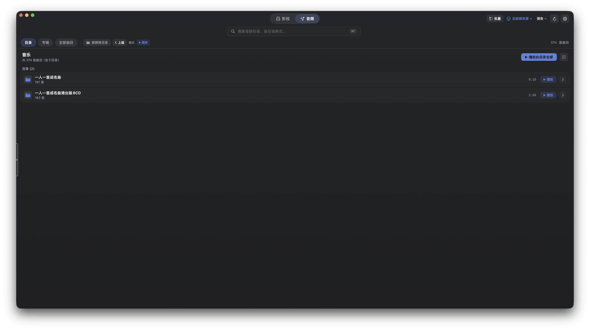
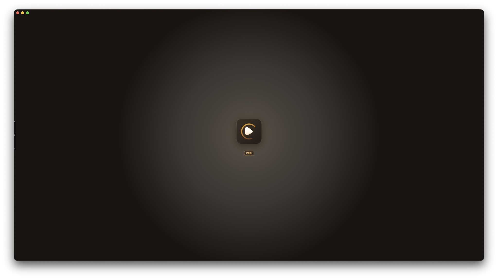
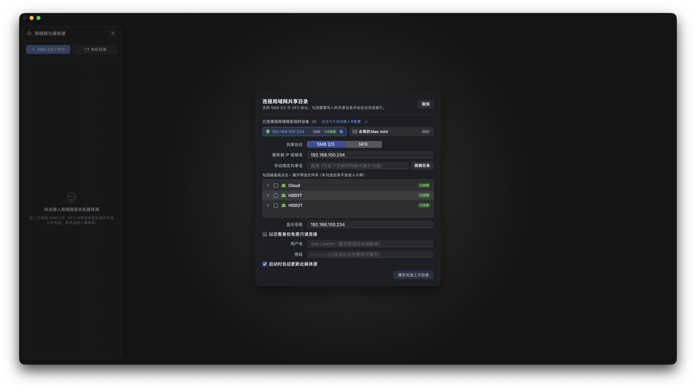
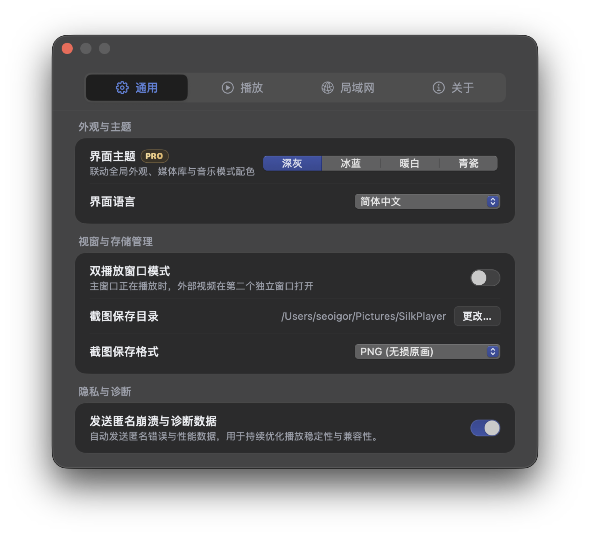
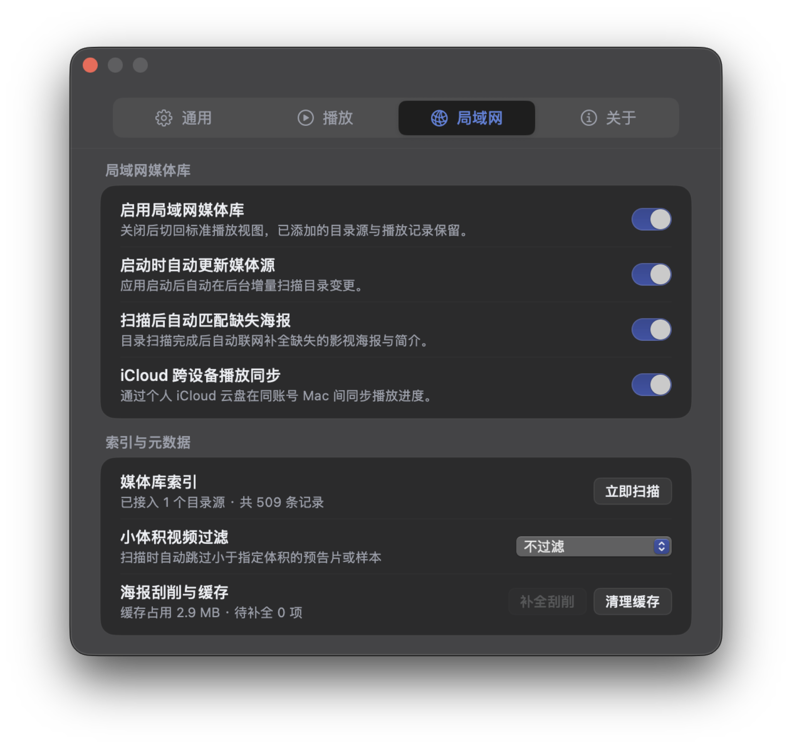
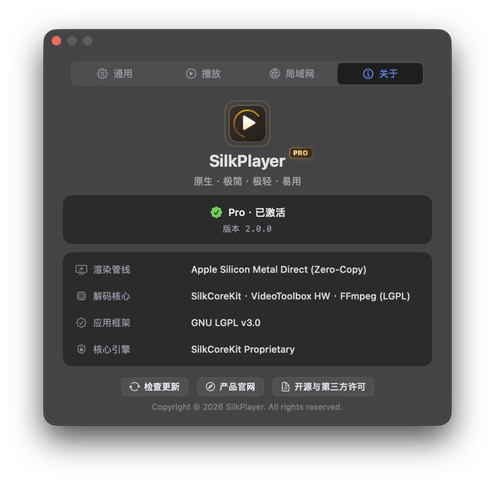

<div align="center">


# SilkPlayer Pro

<p>
  <b>专为 macOS 打造的高端原生影视媒体库与全能播放器。</b><br>
  <b>The premier native media library and cinema player crafted for macOS.</b><br>
  极致流畅的 4K/8K 画质还原、自动整理的私人影视海报墙、独立的黑胶音乐视窗，纯粹且纯净。<br>
  Ultra-smooth 4K/8K playback, automated cinema poster wall, and standalone vinyl music mode.
</p>

<p>
  <a href="https://www.apple.com/macos/"></a>
  <a href="https://www.apple.com/mac/"></a>
  <a href="https://swift.org"></a>
  <a href="scripts/run_tests.sh"></a>
  <a href="LICENSE"></a>
  <a href="https://silkplayer.com"></a>
</p>

<br>


<br>
<sub><em>SilkPlayer Pro · macOS 原生架构 · 局域网影视海报墙 · 杜比视界高动态色彩呈现</em></sub><br>
<sub><em>Native macOS Architecture · LAN Media Library Poster Wall · Dolby Vision High-Dynamic-Range Playback</em></sub>

</div>

<br>

---

### 产品概述 / Product Overview

> **把播放器还给电影，把时间留给享受 / Give the player back to movies, give your time back to enjoyment.**  
> 告别复杂晦涩的解码参数与臃肿卡顿的跨平台界面，带来开箱即用的通透画质、整洁海报墙与纯净原生的 Mac 体验。  
> Leave behind confusing codec settings and sluggish cross-platform wrappers. SilkPlayer Pro delivers stunning visuals, an automated cinema poster wall, and a pure native Mac experience out of the box.

在 Mac 上看电影或听音乐，本该是一件轻松愉悦的事。然而许多传统播放器随着版本迭代，积累了大量令人望而生畏的技术设置、不统一的弹窗与繁重的系统负担。  
SilkPlayer Pro 坚守原生 Mac 软件的高标准：启动即开、拖入即播、画质通透、界面克制。无论是存放在本地磁盘的高清大片，还是家庭网络存储设备中的海量剧集，双击即可呈现原汁原味的视听盛宴。

Watching movies and listening to music on your Mac should be effortless and delightful. Yet many traditional players have become cluttered with complex configuration menus, disjointed dialogs, and heavy system overhead.  
SilkPlayer Pro upholds the finest traditions of native Mac software: instant startup, drop-to-play simplicity, vivid color fidelity, and restrained design. Whether you are playing high-bitrate films stored on your internal drive or streaming massive series from home network storage, SilkPlayer Pro delivers a flawless audiovisual experience from the very first click.

---

### 核心功能与体验亮点 / Feature Showcase & Highlights

<table>
  <tr>
    <td width="50%" valign="top">
      <h4>私人影视海报墙与家庭媒体库<br>Cinema Poster Wall &amp; LAN Hub</h4>
      <ul>
        <li><b>家庭网络存储自动发现 / Automatic Network Storage Discovery</b><br>自动搜索局域网内的群晖、威联通、TrueNAS、Windows 共享等网络存储设备，无需在系统访达手动连接挂载，一键接入影视目录。<br>Automatically discovers LAN storage devices (Synology, QNAP, TrueNAS, Windows Shares) without manual Finder volume mounting.</li>
        <li><b>自动整理与精美海报呈现 / Instant Poster Wall Organization</b><br>自动刮削电影海报、背景画、演职员阵容与剧情简介，完美识别各类现有元数据文件，将凌乱文件夹秒变专业流媒体式海报墙。<br>Instantly turns messy folders into a polished streaming-style poster wall, complete with high-resolution artwork, cast details, and plot summaries.</li>
        <li><b>连续剧多季归拢与智能选集 / Multi-Season Series &amp; Episode Navigation</b><br>整季电视剧自动聚拢归类，提供直观的选集抽屉大网格，单集播放进度清晰可见，追剧不再迷失集数。<br>Aggregates full series into organized season views with a structured episode grid and per-episode resume checkpoints.</li>
        <li><b>沉浸式双栏电影详情页 / Immersive Two-Column Movie Detail</b><br>高分辨率立体海报配合柔和背景环境光，直观呈现 4K、HDR、杜比视界、音频声道及文件体积等完整规格标签。<br>Features ambient blurred backdrops, 3D drop-shadow posters, and clear badges for 4K, HDR, Dolby Vision, audio channels, and file sizes.</li>
        <li><b>智能关联好片推荐 / Contextual Movie Recommendations</b><br>根据当前电影的类型与标签，在详情页右侧贴心推荐风格相近的精彩影片，发现更多私人曲库珍藏。<br>Intelligently highlights similar titles from your collection right beside the movie details based on genres and themes.</li>
        <li><b>高效批量管理 / Seamless Batch Management</b><br>支持一键切换分类、批量重置观看进度、移出海报墙索引，并带有安全防误删确认。<br>Easily switch categories, reset watch progress in bulk, and manage your library with complete trash protection.</li>
      </ul>
    </td>
    <td width="50%" valign="top">
      <h4>极简通透的影院级播放体验<br>Master-Grade Cinema Playback</h4>
      <ul>
        <li><b>4K / 8K 超高清极速直出 / 4K &amp; 8K High-Bitrate Playback</b><br>随心播放超高码率影片，拖拽进度条毫无拖沓，即拖即放，发热极低，长久观影省电安心。<br>Effortlessly plays high-bitrate 4K and 8K videos with instantaneous timeline seeking, low heat generation, and extended battery life.</li>
        <li><b>杜比视界与 HDR 高动态色彩还原 / Dolby Vision &amp; HDR Color Fidelity</b><br>充分释放 Mac 屏幕高动态范围潜力，暗部深邃有层次，高光透亮不过曝，彻底杜绝画面发白与偏色。<br>Unlocks the full dynamic range of your Mac display, delivering deep blacks and vibrant highlights without washed-out colors.</li>
        <li><b>全格式视频通吃 / Universal Video Format Support</b><br>全面支持 MP4、MKV、MOV、FLV、TS、WebM、AVI 等各种主流与专业视频封装，无需转码。<br>Seamlessly handles MP4, MKV, MOV, FLV, TS, WebM, AVI, and all major video containers without conversion.</li>
        <li><b>纯透明悬浮播控栏 / Transparent Floating Controls</b><br>控制条如呼吸般轻盈浮于画面之上，播放时自动隐退，还你纯净无遮挡的全屏沉浸视野。<br>Sleek floating controls hover cleanly over the picture and vanish smoothly during playback for an unobstructed view.</li>
        <li><b>时间轴悬停预览缩略图 / Timeline Hover Thumbnail Previews</b><br>鼠标划过时间轴即刻显示对应画面的高清预览图，精彩片段与精彩对白一击即中。<br>Hover anywhere along the scrubber to view instant high-resolution frame previews for precise scene navigation.</li>
        <li><b>外挂字幕智能关联 / Automatic External Subtitle Matching</b><br>自动寻找同级目录与字幕文件夹下的所有外挂字幕（SRT、ASS、VTT 等），拖放也能即刻挂载。<br>Automatically detects external subtitles (SRT, ASS, VTT) in parent or companion folders, with instant drag-and-drop loading.</li>
      </ul>
    </td>
  </tr>
  <tr>
    <td width="50%" valign="top">
      <h4>独立桌面黑胶音乐播放器<br>Standalone Vinyl Music Mode</h4>
      <ul>
        <li><b>大窗列表与迷你卡片自由切换 / Full Queue &amp; Mini Card Views</b><br>提供展开模式（浏览完整播放队列与歌曲信息）与极简小卡片（随手摆放于桌面角落），适配各种分屏工作流。<br>Smoothly toggle between an expanded playlist queue view and a minimal desktop card tailored for focused workflows.</li>
        <li><b>优雅拟真黑胶唱片视窗 / Realistic Rotating Vinyl Visualizer</b><br>伴随动听旋律缓缓旋转的拟真黑胶唱片，辅以随音乐起伏的柔和动态光晕，工作与学习时的绝佳伴侣。<br>Enjoy a beautifully rendered vinyl disc rotating to the rhythm, complete with a gentle ambient dynamic light glow.</li>
        <li><b>菜单栏常驻随身听 / Menu Bar Resident Micro-Player</b><br>可随时将音乐收拢至 Mac 顶部菜单栏，彻底释放 Dock 栏空间，点击即可快速切歌与调整音量。<br>Minimize directly to the macOS menu bar to keep your Dock clean while retaining one-click playback and track controls.</li>
        <li><b>全格式高解析度无损音质 / Studio-Grade Lossless Audio Playback</b><br>完美还原 FLAC、APE、WAV、DSD、DTS 等母带级无损音频细节，声场宽广，人声纯净通透。<br>Faithfully reproduces FLAC, APE, WAV, DSD, DTS, and studio-grade lossless audio with expansive clarity and warmth.</li>
        <li><b>智能多声道平衡与防破音 / Smart Audio Balance &amp; Protection</b><br>多声道音轨自动平衡，使用耳机或外放音响时人声清晰饱满，大动态电影爆破与交响乐平顺不刺耳。<br>Intelligently balances multichannel tracks for headphones and stereo speakers, ensuring clear dialog and preventing harsh distortion.</li>
      </ul>
    </td>
    <td width="50%" valign="top">
      <h4>纯正 Mac 原生质感与个性化<br>Pure Native Mac Craftsmanship</h4>
      <ul>
        <li><b>4 套高品质主题随心切换 / 4 Curated High-Contrast Themes</b><br>内置经典深灰、深邃黑（OLED 纯黑）、钛金灰、冰霜白 4 款专属主题，完美契合你的桌面壁纸与视觉偏好。<br>Choose from Classic Dark, Deep Onyx (OLED Pure Black), Titanium Gray, and Frost White to complement your Mac setup.</li>
        <li><b>多设备观影进度随行 / Seamless Multi-Device Watch History</b><br>支持在不同 Mac 设备之间同步观影进度，书房看一半，客厅接着看，进度无缝延续。<br>Optionally keeps your playback progress in sync across multiple Mac computers, picking up right where you left off.</li>
        <li><b>播放列表快速拼音搜索 / Instant Playlist Pinyin &amp; Text Search</b><br>直接输入汉字或拼音首字母，海量分集与音频曲目秒级精准过滤，找片找歌无需费神。<br>Filter through massive playlists in seconds using Chinese Pinyin initials or keyword search.</li>
        <li><b>极低资源占用与零多余常驻 / Ultra-Low Resource Footprint</b><br>静态浏览时维持极低系统消耗，退出即彻底释放，没有后台常驻守护进程，不抢占宝贵内存。<br>Maintains near-zero CPU and GPU usage when idle, completely freeing memory on exit with no background daemons.</li>
        <li><b>简洁直观的偏好设置 / Single-Screen Intuitive Preferences</b><br>精心排版的设置界面，一屏尽收眼底，无需在多层嵌套的复杂菜单中反复寻找开关。<br>Carefully designed single-screen preference panes eliminate tedious nested menus and vertical scrolling.</li>
      </ul>
    </td>
  </tr>
</table>

---

### 实机效果全景展示 / 18-Part Feature Gallery

#### 1. 影视媒体库全景与分类管理 / Media Library Overview &amp; Category Filtering

<table>
  <tr>
    <td width="50%" align="center"><b>01. 局域网影视海报墙全景<br>LAN Media Library Poster Wall</b></td>
    <td width="50%" align="center"><b>02. 多源全量聚合与影视分类管理<br>Multi-Source Aggregation &amp; Categories</b></td>
  </tr>
  <tr>
    <td align="center"></td>
    <td align="center"></td>
  </tr>
  <tr>
    <td align="center"><sub>高密度自适应海报网格，悬停即可单点快捷播放，支持快速移出继续观看<br>High-density adaptive poster grid with instant hover-to-play and quick watchlist pruning</sub></td>
    <td align="center"><sub>支持全部媒体源下拉快速切换，电影与剧集一键分流，顶部工具栏轻松筛选<br>Dropdown media source switcher, movie and series classification, and quick top-bar filtering</sub></td>
  </tr>
</table>

<br>

#### 2. 沉浸式电影详情页与连续剧选集 / Movie Detail View &amp; Multi-Season Series

<table>
  <tr>
    <td width="50%" align="center"><b>03. 电影沉浸详情页与 4K 杜比视界规格标签<br>Movie Detail View &amp; Technical Badges</b></td>
    <td width="50%" align="center"><b>04. 连续剧分季选集大网格与相似好片推荐<br>TV Series Multi-Season Grid &amp; Recommendations</b></td>
  </tr>
  <tr>
    <td align="center"></td>
    <td align="center"></td>
  </tr>
  <tr>
    <td align="center"><sub>柔和背景光影、高清海报立体投影、完整剧情简介与右侧智能关联好片推荐<br>Soft ambient backdrop glow, 3D poster shadow, full synopsis, and contextual recommendations</sub></td>
    <td align="center"><sub>整季电视剧大网格选集抽屉，逐集记录播放断点，追剧体验一目了然<br>Structured multi-season episode drawer with individual resume memory for effortless binge-watching</sub></td>
  </tr>
</table>

<br>

#### 3. 4K 超高清杜比视界播放与悬浮播控 / 4K Dolby Vision Playback &amp; Floating HUD

<table>
  <tr>
    <td width="50%" align="center"><b>05. 4K UHD 杜比视界超高清高动态画质直出<br>4K UHD Dolby Vision High-Fidelity Playback</b></td>
    <td width="50%" align="center"><b>06. 纯透明悬浮播控栏与毫秒级进度微调<br>Transparent Floating Scrubber &amp; Controls</b></td>
  </tr>
  <tr>
    <td align="center"></td>
    <td align="center"></td>
  </tr>
  <tr>
    <td align="center"><sub>充分释放屏幕高动态画质潜力，暗部细节丰富深邃，高光通透自然，色彩真实还原<br>Delivers expansive dynamic contrast with deep shadow detail, pristine highlights, and faithful colors</sub></td>
    <td align="center"><sub>纯透明悬浮播控胶囊，播放时自动优雅隐退，无任何多余方框遮挡观影视野<br>Minimalist floating pill control bar that fades away cleanly with zero opaque bottom boxes</sub></td>
  </tr>
  <tr>
    <td colspan="2" align="center"><b>07. 视频规格属性与音画详细信息悬浮面板<br>Live Stream Properties &amp; Video Metadata Overlay</b></td>
  </tr>
  <tr>
    <td colspan="2" align="center"></td>
  </tr>
  <tr>
    <td colspan="2" align="center"><sub>随时查看当前视频的实际分辨率、帧率、色彩格式与音频通道详细参数<br>Inspect live resolution, frame rate, color space, and audio channel parameters at any moment</sub></td>
  </tr>
</table>

<br>

#### 4. 独立桌面黑胶音乐播放器与无损曲库 / Standalone Vinyl Music Mode &amp; Audio Library

<table>
  <tr>
    <td width="50%" align="center"><b>08. 独立音乐播放器：展开模式与黑胶旋转视窗<br>Music Mode: Expanded Queue &amp; Vinyl Visualizer</b></td>
    <td width="50%" align="center"><b>09. 独立音乐播放器：极简桌面伴侣小卡片<br>Music Mode: Minimal Desktop Companion Card</b></td>
  </tr>
  <tr>
    <td align="center"></td>
    <td align="center"></td>
  </tr>
  <tr>
    <td align="center"><sub>优雅旋转的拟真黑胶唱片与随音乐起伏的柔和光晕，支持一键最小化至顶部菜单栏常驻<br>Realistic rotating vinyl disc with dynamic ambient glow; supports direct minimization to the menu bar</sub></td>
    <td align="center"><sub>随手摆放在桌面角落或分屏边缘的超紧凑卡片，清晰呈现高清专辑封面与播控按钮<br>Ultra-compact card for desk placement or split-screen multitasking with embedded artwork and controls</sub></td>
  </tr>
  <tr>
    <td colspan="2" align="center"><b>14. 本地无损音频曲库一体化管理<br>Local Lossless Audio Track Library Management</b></td>
  </tr>
  <tr>
    <td colspan="2" align="center"></td>
  </tr>
  <tr>
    <td colspan="2" align="center"><sub>集中管理本地无损音乐曲目，支持按歌手、专辑与曲目快速检索定位<br>Manage local lossless audio tracks in one centralized view with instant searching across artists and albums</sub></td>
  </tr>
</table>

<br>

#### 5. 家庭网络存储与局域网设备接入全流程 / LAN Storage &amp; Network Setup Guide

<table>
  <tr>
    <td width="50%" align="center"><b>10. 媒体库初始页面与极简接入向导<br>Library Welcome &amp; Onboarding Guide</b></td>
    <td width="50%" align="center"><b>11. 局域网网络存储连接指引面板<br>LAN Storage Connection Guide</b></td>
  </tr>
  <tr>
    <td align="center"></td>
    <td align="center"></td>
  </tr>
  <tr>
    <td width="50%" align="center"><b>12. 局域网设备全自动扫描发现列表<br>Automatic LAN Storage Device Discovery List</b></td>
    <td width="50%" align="center"><b>13. 远程共享服务连接与多目录勾选<br>Remote Share Authentication &amp; Folder Selection</b></td>
  </tr>
  <tr>
    <td align="center"></td>
    <td align="center"></td>
  </tr>
  <tr>
    <td colspan="2" align="center"><sub>告别在系统访达里反复配置网络驱动器的繁琐操作，自动搜索局域网设备，一键勾选共享文件夹即刻生成海报墙<br>Skip tedious manual network mounting in Finder; auto-discover local storage and check folders to build your cinema library</sub></td>
  </tr>
</table>

<br>

#### 6. 偏好设置与 4 款高品质主题切换 / Preferences &amp; 4 Curated Themes

<table>
  <tr>
    <td width="50%" align="center"><b>15. 通用设置：外观与 4 款高品质主题随心选<br>General Settings: Appearance &amp; 4 Curated Themes</b></td>
    <td width="50%" align="center"><b>16. 播放与连续性设置：紧凑零滚动舒适布局<br>Playback Settings: Compact Zero-Scrolling Layout</b></td>
  </tr>
  <tr>
    <td align="center"></td>
    <td align="center"></td>
  </tr>
  <tr>
    <td width="50%" align="center"><b>17. 局域网媒体库设置：多设备云端同步控制<br>LAN Settings: Multi-Device Sync Control</b></td>
    <td width="50%" align="center"><b>18. 关于面板：SilkPlayer Pro 软件信息与硬件规格<br>About Panel: SilkPlayer Pro Specs &amp; Licensing</b></td>
  </tr>
  <tr>
    <td align="center"></td>
    <td align="center"></td>
  </tr>
  <tr>
    <td colspan="2" align="center"><sub>精心微调的设置面板，所有选项一屏尽览无纵向滚动条，4 款精美主题全局联动所有视窗<br>Refined layouts eliminate vertical scrolling, while four distinct themes synchronize seamlessly across all windows</sub></td>
  </tr>
</table>

---

### 系统运行要求 / System Requirements

* **操作系统 / OS**: macOS 14.0 (Sonoma) 或 / or macOS 15.0+ (Sequoia)
* **硬件平台 / Architecture**: Universal 通用二进制架构（原生支持 Apple Silicon M1-M6 全系列芯片与 Intel 64 位处理器）/ Universal Binary natively supporting Apple Silicon (M1-M6) and Intel 64-bit Macs
* **显示支持 / Display**: 支持标准显示器、Retina 视网膜屏幕与 Pro Display XDR 等高动态范围显示设备 / Standard, Retina, and HDR/EDR displays supported

---

### 获取与安装 / Download &amp; Installation

#### 方式一：官方全球高速直连下载 / Option 1: Direct Edge Download (Recommended)

直接从官方全球网络高速下载最新通用安装镜像（满速秒下，无任何跳转与拦截）：  
Download the latest universal disk image directly from our global network:

* **通用安装镜像 / Universal DMG (Apple Silicon &amp; Intel)**: [SilkPlayer-universal.dmg](https://silkplayer.com/api/download)（安装包体积仅 22.8 MiB，精简轻巧 / 22.8 MiB, ultra-compact）

亦可前往 / Alternatively download from [GitHub Releases](https://github.com/meowvia/SilkPlayer/releases/latest)。

#### 方式二：拖拽安装 / Option 2: Drag-and-Drop Installation

1. 双击打开 `SilkPlayer-2.0.0-universal.dmg`；  
   Open `SilkPlayer-2.0.0-universal.dmg`;
2. 将 `SilkPlayer.app` 图标拖入右侧的 `Applications`（应用程序）文件夹中；  
   Drag `SilkPlayer.app` into your Applications folder;
3. 从启动台（Launchpad）或应用程序目录打开使用。  
   Launch from Applications or Launchpad.

> [!TIP]
> **macOS 首次打开提示 / macOS Gatekeeper Notice**  
> 若系统提示“未验证开发者”或隔离警告（属于开源未公证软件的标准提示），在「应用程序」中按住键盘 `Control` 键并点击应用，选择「打开」即可永久授权信任。  
> If macOS displays an "unidentified developer" or quarantine notice, open your Applications folder in Finder, hold down the `Control` key, click `SilkPlayer.app`, and select `Open` to permanently authorize the application.  
> 亦可在系统「终端」中执行以下单行命令快速放行 / Or run this single command in Terminal:
> ```bash
> sudo xattr -rd com.apple.quarantine /Applications/SilkPlayer.app
> ```

---

### 软件许可与版权声明 / Licensing &amp; Disclaimers

* **开源前端组件 / Open-Source Components**: 前端宿主代码遵循 [GNU Lesser General Public License v3.0 (LGPL-3.0)](LICENSE) 开源协议；  
  Frontend host application components are released under the GNU Lesser General Public License v3.0 (LGPL-3.0).
* **商业核心与高级功能 / Proprietary Core &amp; Pro Features**: 受专有许可协议 [SILKCOREKIT_LICENSE.md](SILKCOREKIT_LICENSE.md) 保护，个人非商业用途可自由体验。  
  Protected under the dedicated license agreement [SILKCOREKIT_LICENSE.md](SILKCOREKIT_LICENSE.md) for personal, non-commercial evaluation.

#### 商标与影视资产免责声明 / Trademark &amp; Media Disclaimers
* **商标归属 / Trademarks**: Apple、macOS、Apple Silicon、MacBook、Retina 与 Finder 均为 Apple Inc. 的注册商标；Dolby 与 Dolby Vision 均为杜比实验室（Dolby Laboratories）的注册商标；SilkPlayer Pro 为独立软件项目，与上述实体无附属或代言关系。  
  Apple, macOS, Apple Silicon, MacBook, Retina, and Finder are trademarks of Apple Inc. Dolby and Dolby Vision are trademarks of Dolby Laboratories. SilkPlayer Pro is an independent software project with no affiliation or endorsement.
* **影视素材说明 / Media Assets Notice**: 截图中出现的影视海报、元数据、剧照与商标仅用于软件界面效果的功能性演示，其版权归各自制片方或权利人所有。SilkPlayer Pro 本身不内置、不提供、亦不分发任何受版权保护的多媒体内容。  
  All posters, metadata, movie stills, and trademarks depicted in screenshots are the property of their respective copyright owners and are utilized strictly for functional software demonstration. SilkPlayer Pro does not host, bundle, or distribute any copyrighted media.
