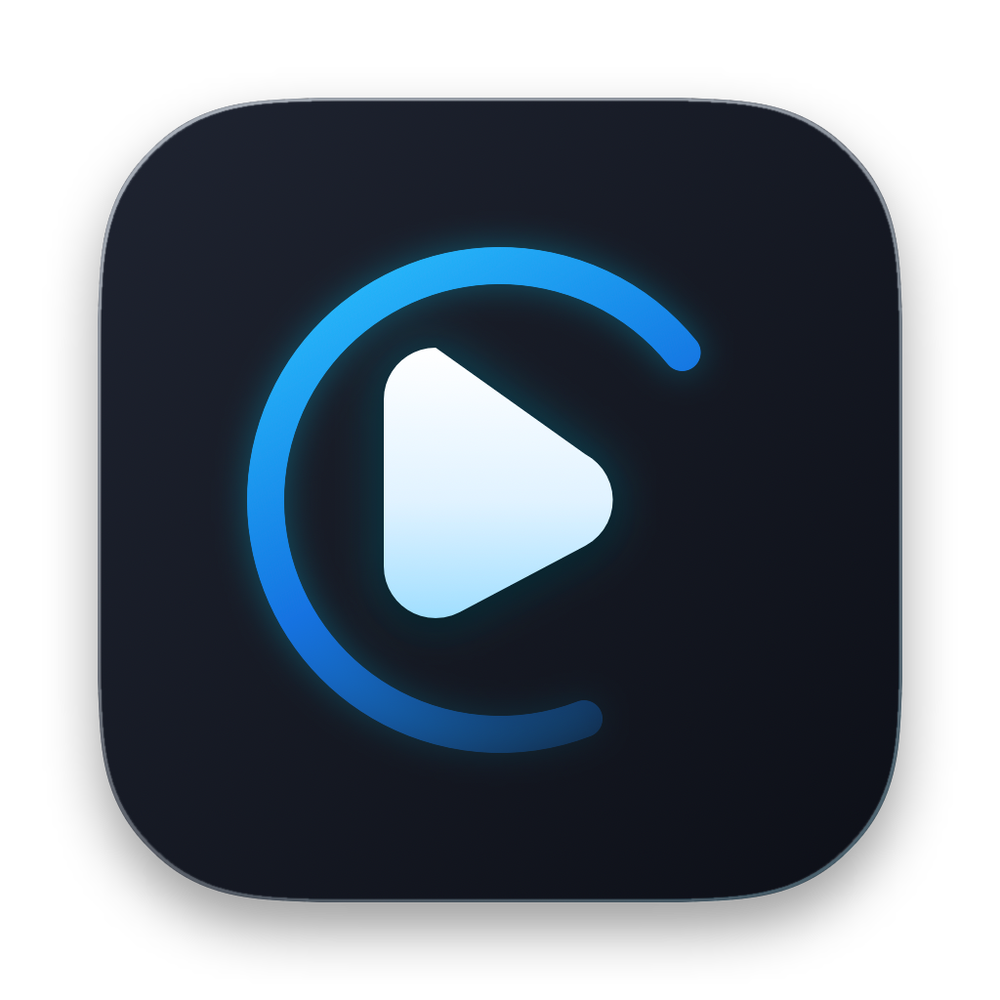
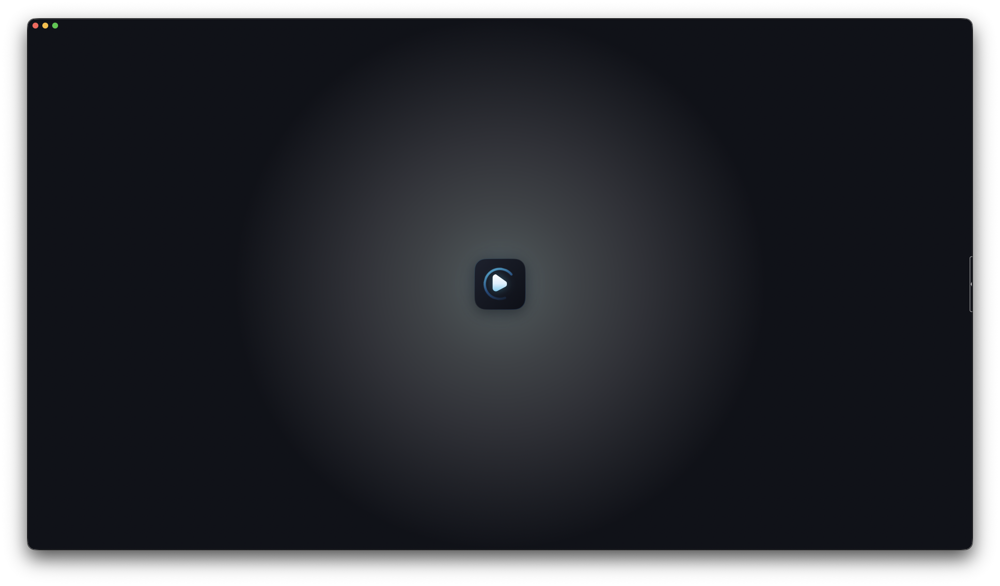
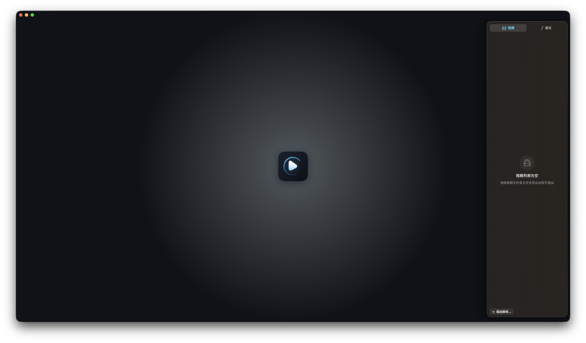
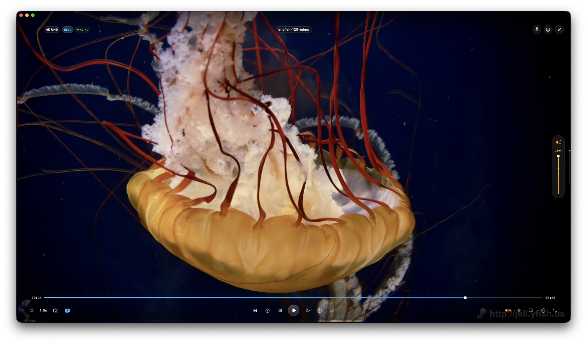
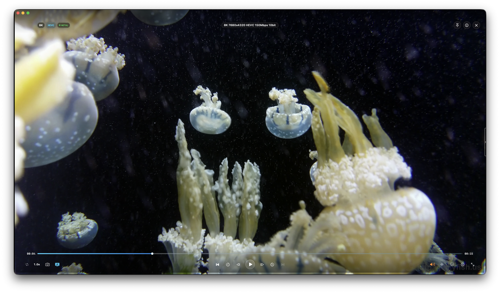
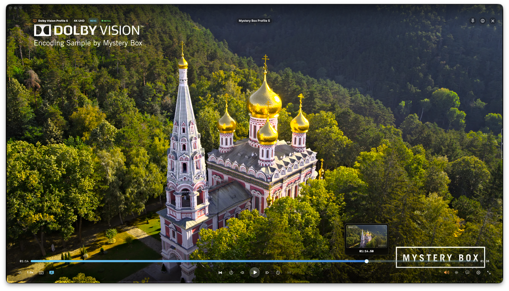
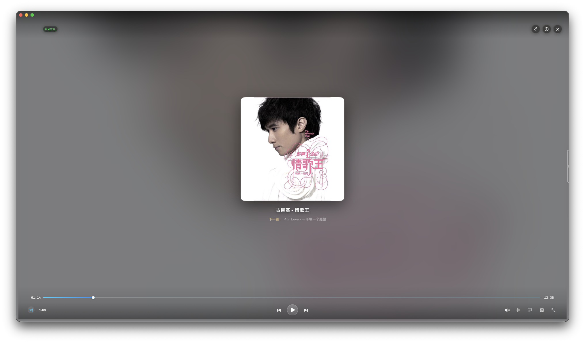
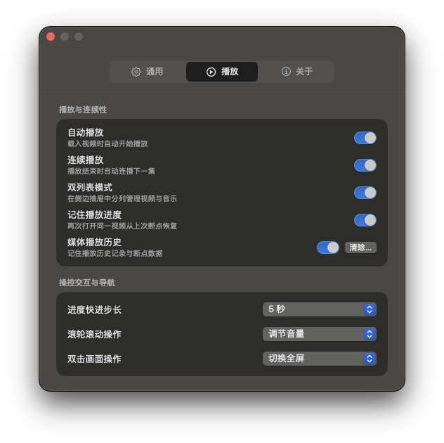
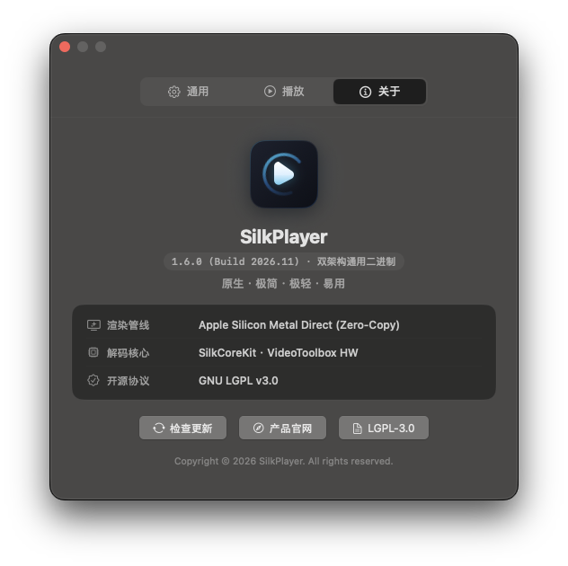

<div align="center">



# SilkPlayer

<p><b>专为 macOS 打造的原生、轻量化多媒体播放器</b><br>
专注轻量、速度、易用性与纯净的本地观影体验</p>

<p>
  <a href="https://www.apple.com/macos/"></a>
  <a href="https://www.apple.com/mac/"></a>
  <a href="https://swift.org"></a>
  <a href="scripts/run_tests.sh"></a>
  <a href="LICENSE"></a>
</p>

<p>
  <a href="README.md">English</a> &nbsp;|&nbsp; <b>简体中文</b>
</p>

<br>


<br>
<sub><em>极简无边框设计 · 打开即用，直接拖入视频或点击中央图标即可播放</em></sub>

</div>

<br>

---

### 产品说明

> **极简、原生、即开即用**  
> 减少繁琐的参数配置，将硬件解码、色彩还原与常用播放控制设为默认启用，让观影体验回归纯粹。

在 macOS 平台上，许多本地播放器功能非常丰富，但随着功能增加，设置项也变得相对复杂。SilkPlayer 的初衷是追求原生、轻量与易用。我们希望省去各类晦涩的编解码配置与调试开关，让用户打开视频就能直接观看，享受轻快流畅的视听体验。

---

### 产品架构与工程实现

SilkPlayer 没有采用任何网页打包或跨平台套壳方案，完全基于 Apple 原生技术栈构建：

* **macOS 原生开发**  
  使用 SwiftUI 与 AppKit 混合构建，不采用 Electron 等网页打包框架。遵循 macOS 人机交互指南（HIG），深色模式、毛玻璃材质与原生窗口操作均由系统底层直接驱动。

* **Swift 6 并发模型**  
  全面采用 Swift 6 语言规范与现代结构化并发模型，对界面渲染、播放核心控制与文件读取遵循严格的 `@MainActor` 隔离与 Sendable 边界，在编译阶段检查并避免多线程数据冲突，提升播放稳定性。

* **基于 Metal 的 HDR 与杜比视界色调映射**  
  利用 Apple Metal 图形接口处理 Dolby Vision Profile 5 与 HDR10 视频的硬件色调映射（Tone Mapping），结合显示器的实际物理亮度（EDR Headroom）动态微调高光曲线，呈现层次真实的光影，减少强光画面的过曝发白。

* **视频缩略图预览机制**  
  采用按需读取与动态内存缓存策略，仅在鼠标划过进度条时生成对应时间点的缩略图，避免预先读取整部视频文件，减少不必要的磁盘与内存开销。

* **系统资源开销控制**  
  去除了跨平台框架常驻后台的资源占用，解码与渲染缓冲区随播放需要动态分配，停止播放后及时释放，减少笔记本运行时的耗电与发热。

---

### 产品核心功能

<table>
  <tr>
    <td width="50%" valign="top">
      <h4>核心解码与画质</h4>
      <ul>
        <li><b>音视频全格式解码</b><br>内置针对 macOS 优化的 FFmpeg 库，原生支持 MP4、MKV、MOV、FLV、TS、WebM、AVI 等主流容器，支持 4K 与 8K 分辨率下的 H.264、HEVC (H.265)、AV1、VP9 与 ProRes 硬件解码。</li>
        <li><b>HDR10 与杜比视界</b><br>完整支持 HDR10 与杜比视界（Dolby Vision Profile 5 与 Profile 8 等）视频播放，结合显示器物理动态范围呈现准确的高光与阴影细节。</li>
        <li><b>画质调节与去色带</b><br>提供去色带（Deband）滤镜，减少渐变画面的色彩断层；支持实时微调亮度、对比度、饱和度与锐化参数。</li>
        <li><b>画面旋转与镜像翻转</b><br>支持画面以 90 度为步长顺时针旋转，以及水平镜像翻转（适合舞蹈教学、运动回放或反向镜头素材）。</li>
      </ul>
    </td>
    <td width="50%" valign="top">
      <h4>交互播控与媒体管理</h4>
      <ul>
        <li><b>进度条缩略图预览</b><br>鼠标悬停在进度条上方时，即时呈现对应时间点的高清缩略图与精准时间戳，快进快退所见即所寻。</li>
        <li><b>视频章节与快速跳转</b><br>自动识别视频内嵌的章节信息并在时间轴上清晰标注，支持在不同章节之间快速切换。</li>
        <li><b>逐帧播放与步长快进</b><br>支持键盘快捷键（<code>[</code> 与 <code>]</code>）逐帧步进与步退，支持在偏好设置中自定义快进与快退的秒数步长。</li>
        <li><b>播放列表与音频模式</b><br>支持连续剧与单片双轨分流管理，剧集按自然语义连贯排序；播放音频文件（FLAC、APE、WAV、MP3 等）自动收拢为紧凑方形视窗，呈现专辑封面与黑胶动态旋转。</li>
        <li><b>播放列表文件名清洗</b><br>自动过滤压制组名、分辨率、视频编码与冗余字符，提取清晰的剧集名称与集数标签（悬停仍可查看完整物理文件名）。</li>
        <li><b>外挂字幕与多音轨切换</b><br>自动加载同目录下同名外挂字幕（支持 SRT、ASS/SSA、VTT 等格式，保留 ASS 特效排版）；支持切换内嵌多语言音轨，并提供音频与字幕延迟时间微调。</li>
        <li><b>自动隐藏沉浸式播控栏</b><br>严格遵循 macOS 原生人机交互规范，进度条与播控组件悬浮于画面上方，鼠标静止时平滑淡出隐藏，最大化还原本真无干扰的观影画板。</li>
      </ul>
    </td>
  </tr>
</table>

---

### 界面实机预览画廊

#### 1. 极简画布与音视频双列表

<table>
  <tr>
    <td width="50%" align="center"><b>极简无边框启动态</b></td>
    <td width="50%" align="center"><b>音视频双列表抽屉与智能清洗</b></td>
  </tr>
  <tr>
    <td align="center"></td>
    <td align="center"></td>
  </tr>
  <tr>
    <td align="center"><sub>启动后呈现纯黑极简画布，点击中央图标或拖入文件即可播放</sub></td>
    <td align="center"><sub>支持连续剧与独立影片双轨分流，内置文件名智能清洗降噪</sub></td>
  </tr>
</table>

<br>

#### 2. 高码率硬件回放实测

<table>
  <tr>
    <td width="50%" align="center"><b>4K UHD 播放与实时音量增益</b></td>
    <td width="50%" align="center"><b>8K 7680×4320 极限解码实测</b></td>
  </tr>
  <tr>
    <td align="center"></td>
    <td align="center"></td>
  </tr>
  <tr>
    <td align="center"><sub>实测 4K UHD 播放，支持最高 200% 音量软增益与实时顶部 HUD 反馈</sub></td>
    <td align="center"><sub>实测 8K 7680×4320 150Mbps 极限码率样片，展现高能耗比硬件解码</sub></td>
  </tr>
</table>

<br>

#### 3. 杜比视界色彩映射与音乐模式

<table>
  <tr>
    <td width="50%" align="center"><b>杜比视界 Profile 5 与进度条预览</b></td>
    <td width="50%" align="center"><b>紧凑方形黑胶音乐模式</b></td>
  </tr>
  <tr>
    <td align="center"></td>
    <td align="center"></td>
  </tr>
  <tr>
    <td align="center"><sub>流媒体 Dolby Vision Profile 5 动态色彩校正，悬停即时浮现时间轴缩略图</sub></td>
    <td align="center"><sub>载入纯音频时自动切入紧凑方形视窗，提取内嵌封面呈现黑胶动态效果</sub></td>
  </tr>
</table>

<br>

#### 4. 原生偏好设置与关于面板

<table>
  <tr>
    <td width="50%" align="center"><b>极简播控偏好设置</b></td>
    <td width="50%" align="center"><b>技术规格与 SilkCoreKit 核心架构</b></td>
  </tr>
  <tr>
    <td align="center"></td>
    <td align="center"></td>
  </tr>
  <tr>
    <td align="center"><sub>原生偏好设置面板，提供简洁实用的快捷键、快进步长与画质调节开关</sub></td>
    <td align="center"><sub>关于面板清楚标明版本技术规格、三大专有核心与合规依据</sub></td>
  </tr>
</table>

---

### 关于核心库 (SilkCoreKit)

SilkPlayer 的界面与交互完全开源，对所有人免费。底层的播放、渲染与抽帧三大核心封装在独立二进制库 `SilkCoreKit` 中。

SilkCoreKit 凝聚了大量业余时间与性能调优积累，为了保障架构稳定，目前仍处于持续测试阶段，暂时以闭源二进制形式提供。后续会视项目发展情况，考虑逐步开源或提供授权。

---

### 系统环境要求

* **操作系统**：macOS 14.0 (Sonoma) 或 macOS 15.0+ (Sequoia) *(Releases 页面提供兼容 macOS 12 Monterey 的独立测试包)*
* **硬件架构**：双架构原生支持（Apple Silicon M 系列芯片 与 Intel x86_64 架构）

---

### 安装与运行

#### 方式一：Homebrew 一键安装（推荐）

```bash
brew install --cask meowvia/tap/silkplayer
```

#### 方式二：下载 DMG 安装包（双架构原生支持）

1. 从 [Releases](https://github.com/meowvia/SilkPlayer/releases) 页面根据您的 Mac 芯片架构下载对应安装包：
   * **Apple Silicon (M1/M2/M3/M4)**：`SilkPlayer-1.5.1-arm64-fix.dmg` (或 Universal 通用包)
   * **Intel Mac (x86_64)**：`SilkPlayer-1.5.1-x86_64-fix.dmg`
2. 双击打开并将 **SilkPlayer.app** 拖入「应用程序」文件夹；
3. 打开即可使用。

> [!TIP]
> **若打开时提示“已损坏”或“无法验证开发者”**（开源应用未向苹果购买商业证书的安全保护提示），在终端执行以下命令即可正常运行：
> ```bash
> xattr -cr /Applications/SilkPlayer.app
> ```
> *(也可在 Mac「系统设置」➔「隐私与安全性」中点击「仍要打开」)*

---

### 从源码自行编译

如果您希望自行构建应用：

```bash
git clone https://github.com/meowvia/SilkPlayer.git
cd SilkPlayer

# 运行全套自动化测试套件
./scripts/run_tests.sh

# 编译打包发布版 DMG
./scripts/package_app.sh 1.5.1 universal
```

> **构建说明**：
> * FFmpeg 五个核心多媒体库以动态 framework（LGPL-3.0）形式直接附带在工程 `Packages/` 目录下；
> * 核心解码与渲染引擎 `SilkCoreKit` 为二进制库（静态链接），在执行 `swift build` 或打包时由 SwiftPM 自动从 GitHub Releases 下载对应的预编译 XCFramework 压缩包；本地开发者亦可遵循 [CONTRIBUTING.md](CONTRIBUTING.md) 放入本地编译的 `Packages/SilkCoreKit.xcframework` 进行开发。

---

### 产品展望

SilkPlayer 目前仍处于早期版本，许多功能与细节还在持续改进中。我们会认真参考用户的反馈与建议，持续优化播放体验。

SilkPlayer 的基础本地播放功能面向广大用户免费开放使用。如果您在使用中遇到问题或有改进建议，欢迎随时提交 [Issues](https://github.com/meowvia/SilkPlayer/issues)，帮助我们持续打磨与优化。

---

### 开源项目致谢

SilkPlayer 衷心致谢以下开源基石项目：

* **[FFmpeg](https://ffmpeg.org)** (LGPL-3.0 动态 framework)
* **[libplacebo](https://code.videolan.org/videolan/libplacebo)** 与 **[mpv](https://github.com/mpv-player/mpv)** (LGPL-2.1+，色彩科学与国际标准对照参考)

#### 商标与声明
* Apple, macOS, Apple Silicon, Metal, VideoToolbox, AppKit 及 SwiftUI 为 Apple Inc. 的注册商标；
* Dolby 及 Dolby Vision 为 Dolby Laboratories 的注册商标；
* SilkPlayer 为独立软件项目，与 Apple Inc. 或 Dolby Laboratories 无附属或背书关系。

#### 架构与开源许可证（双轨许可结构）
* **前台应用（SilkPlayer）**：遵循 [GNU Lesser General Public License v3.0 (LGPL-3.0)](LICENSE) 许可协议，开源前端完全自由分发；
* **多媒体底层库（FFmpeg）**：五个基础库（Libavcodec, Libavformat, Libavutil, Libswresample, Libswscale）均为 LGPL-3.0 动态 framework 链接；
* **核心引擎（SilkCoreKit）**：遵循独立的专有组件使用协议 [SILKCOREKIT_LICENSE.md](SILKCOREKIT_LICENSE.md)，免费供个人非商业使用，作为 SilkPlayer 组件通过 Swift package 物理隔离；
* 详细依赖与重新链接说明请参见 [THIRD_PARTY.md](Documentation/THIRD_PARTY.md)。
